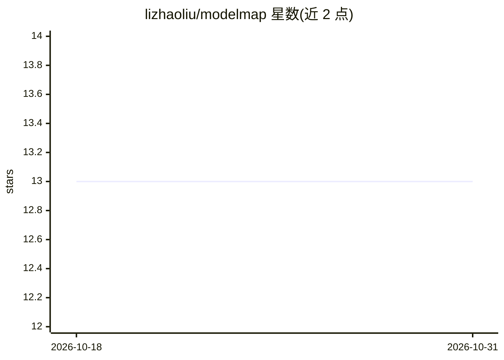

# lizhaoliu/modelmap

⭐ 13 · Python · MIT · 推送 2026-09-10 · [GitHub](https://github.com/lizhaoliu/modelmap) · [官网](https://modelmap.cc) · 个人维护

**Hugging Face 模型架构可视化地图：免下载权重即看结构与显存规划**

输入 Hugging Face 模型 id，仅获取 config.json（约 2 KB），在 PyTorch meta device 上实例化模型并跑一次带 hook 的假前向，捕获真实执行顺序与张量形状，输出可缩放折叠的层级架构图，附带 Flow 动画、两模型结构对比、cost/vram 透镜、serving 与微调（LoRA/QLoRA/ZeRO）显存规划器。支持 GGUF 量化变体、本地 checkpoint、导出 PNG/CSV/JSON/DOT，提供 REST/Python/CLI/MCP 接口；小模型可在浏览器内做真实推理。面向需要理解模型结构与评估硬件可行性的开发者。

## 筛选速览

| 维度 | 判定 | 备注 |
|---|---|---|
| AI 角色 | `ai-ecosystem` | LLM/agent 周边工具 |
| 许可风险 | `permissive` | MIT |
| 部署形态 | `library` | 以包/库形式分发 |
| 模型依赖 | — | README 未给出锁定关系 |
| 硬件要求 | — | 无带数字的原话,不猜 |
| 安装摩擦 | `medium` | 含编译或系统依赖之一 |
| 成熟度 | — | 结构信号不足 |

## 能力要点

- 不下载权重，meta device 假前向捕获真实执行顺序与张量形状
- cost/vram 透镜：按上下文/批大小/精度实时估算显存与算力，回答 will it fit
- 两模型按路径与角色对齐的结构 diff 与量化结论
- REST / Python / CLI / MCP 多接口，支持 GGUF 量化与本地 checkpoint

## 适用场景

- 查看一个模型的结构与每层张量形状，不下载权重
- 部署前评估模型能否装进我的 GPU、KV cache 占多少
- 对比基座与微调版/两代模型的结构差异
- 给编码 agent 接 MCP 工具做显存规划查询

## 场景标签

 · 领域:LLM 基础设施/可视化

## 证据(README 行号)

> L7: **No weights are ever downloaded.** modelmap fetches `config.json` (~2 KB), instantiates
> L8: the model on PyTorch's meta device, runs a hooked fake forward pass to capture real
> L69:  **MCP server** so a coding agent can ask "will Qwen3-32B fit on 2×A100 at 32k?" — see docs/API.md.

## 星数曲线

2026-10-18 13 → 2026-10-31 13（+0）

---
*卡片 v1 · prompt 1.4 · 生成 2026-10-31 · 置信度 mid · 依据 README sha `cb88c987dcd1` · [字段定义](../../DATASET.md)*
