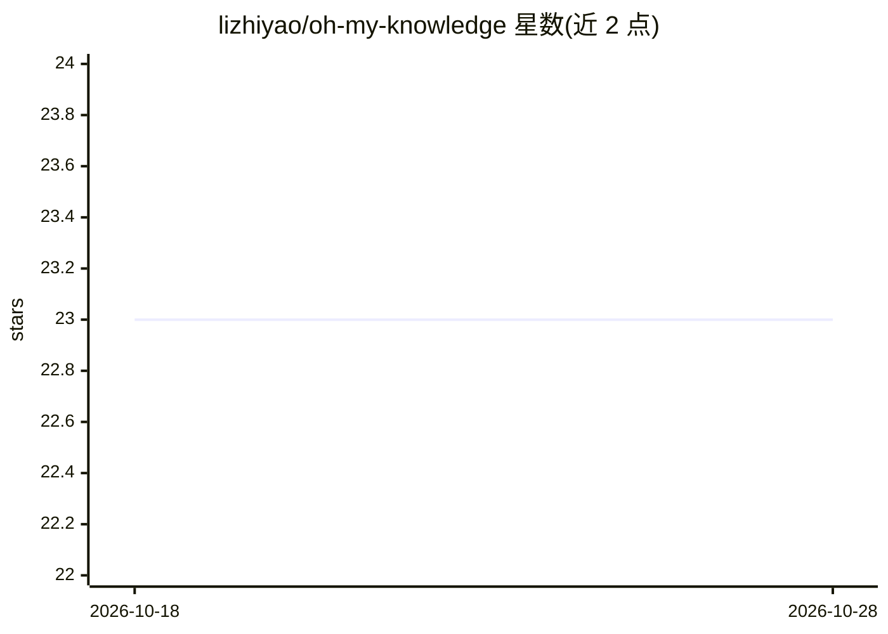

# lizhiyao/oh-my-knowledge

⭐ 23 · TypeScript · MIT · 推送 2026-10-27 · [GitHub](https://github.com/lizhiyao/oh-my-knowledge) · [官网](https://oh-my-knowledge.pages.dev) · 个人维护 · 中文 README

**面向 agent 用户与 AI 应用开发者的评测与知识维护工具**

OMK 以 npm CLI 与本地 Studio 形式提供：从真实工作记录（如 Codex 任务）中提取知识候选项，人工审阅来源与条件后生成带引用的 artifact；知识变更时可在受控条件下直接比对两个 artifact 版本，记录执行条件、不确定度与失败案例证据。抽取候选需调用模型（需先配置认证运行时），也支持在服务中嵌入离线评测、在 agent 或 DSH 中通过 Skill/MCP/宿主插件使用。要求 Node.js ≥22，当前 @next 频道为 beta，API 与存储契约可能变更，升级前需备份。

## 筛选速览

| 维度 | 判定 | 备注 |
|---|---|---|
| AI 角色 | `ai-ecosystem` | LLM/agent 周边工具 |
| 许可风险 | `permissive` | MIT |
| 部署形态 | `library` | 以包/库形式分发 |
| 模型依赖 | — | README 未给出锁定关系 |
| 硬件要求 | — | 无带数字的原话,不猜 |
| 安装摩擦 | `low` | 无编译、无系统依赖或容器化 |
| 成熟度 | `idea` | |

## 能力要点

- 从本地工作记录提取知识候选并生成带引用的 artifact
- 受控条件下比对两个 artifact 版本并记录证据与不确定度
- 支持在服务中嵌入评测、在 agent/DSH 中以 Skill/MCP/插件方式使用
- 知识显式保存在所选工作区内，执行证据与机器偏好独立存储

## 适用场景

- 维护和修订围绕 SDK 等对象积累的知识与 prompt/skill
- 在固定模型与用例下比较两个知识 artifact 版本的差异
- 在本地任务验收中独立核验 agent 的文件变更

## 场景标签

`模型评测` `提示工程` `知识库管理` · 领域:Agent 开发

## 证据(README 行号)

> L11: OMK is for agent users and AI application developers. Extract candidates from real work, review sources and conditi
> L37: - **Compare two artifacts directly**: preview the plan in the evaluation quickstart, configure a runtime, then call
> L39: - **Use OMK inside agents or DSH**: install the official Skill, submit MCP feedback, or use the DSH host plugin.

## 星数曲线

2026-10-18 23 → 2026-10-28 23（+0）

---
*卡片 v1 · prompt 1.4 · 生成 2026-10-27 · 置信度 high · 依据 README sha `6dd3f6bf4aea` · [字段定义](../../DATASET.md)*
