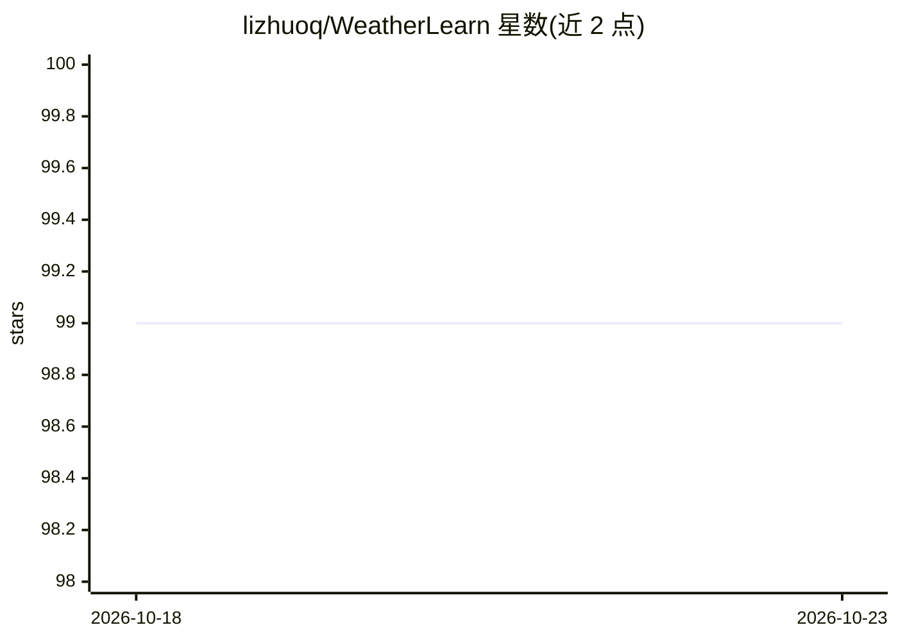

# lizhuoq/WeatherLearn

⭐ 99 · Python · MIT · 推送 2026-09-28 · [GitHub](https://github.com/lizhuoq/WeatherLearn) · 个人维护

**PyTorch 气象深度学习模型库：复现盘古/FuXi/FengWu 等预报模型**

以 PyTorch 实现的气象深度学习模型集合（Model Zoo），收录 Pangu-Weather（含 lite 版）、FuXi、FengWu（含 lite 版）三个全球气象预报模型的实现，提供 Python API 调用与预训练权重推理路径，附带单元测试、FuXi 末层结构说明文档及基于公开 GCS ERA5 数据的 FengWu 训练冒烟脚本。依赖 Python 3.11、torch>=2.1、timm、numpy、cdsapi，通过 pip 可编辑安装或 Poetry 安装。面向气象 AI 研究与开发用户，各模型实现均给出对应论文引用。

## 筛选速览

| 维度 | 判定 | 备注 |
|---|---|---|
| AI 角色 | `ai-native` | 本体是模型或模型工具 |
| 许可风险 | `permissive` | MIT |
| 部署形态 | `library` | 以包/库形式分发 |
| 模型依赖 | — | README 未给出锁定关系 |
| 硬件要求 | — | 无带数字的原话,不猜 |
| 安装摩擦 | `low` | 无编译、无系统依赖或容器化 |
| 成熟度 | — | 结构信号不足 |

## 能力要点

- Pangu-Weather、FuXi、FengWu 及各自 lite 版的 PyTorch 实现
- FengWu 默认 13 层/69 通道，可切换论文配置 37 层/189 通道
- 提供基于公开 GCS ERA5 数据的训练冒烟脚本
- 支持使用盘古官方仓库提供的预训练权重推理

## 适用场景

- 用 PyTorch 加载并推理全球气象预报模型
- 在 ERA5 数据上复现或调试 FengWu 训练流程
- 研究 FuXi/FengWu 的模型结构末层与通道配置差异

## 场景标签

`模型训练` · 领域:训练与推理

## 证据(README 行号)

> L3: Implementation of the PyTorch version of the Weather Deep Learning Model Zoo.
> L28: ### Pangu-Weather

## 星数曲线

2026-10-18 99 → 2026-10-23 99（+0）

---
*卡片 v1 · prompt 1.4 · 生成 2026-10-23 · 置信度 high · 依据 README sha `a1f8e574934c` · [字段定义](../../DATASET.md)*
