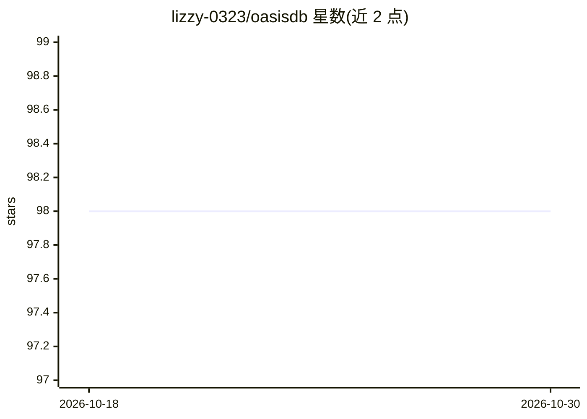

# lizzy-0323/oasisdb

⭐ 98 · Go · Apache-2.0 · 推送 2026-04-14 · [GitHub](https://github.com/lizzy-0323/oasisdb) · 个人维护 · 中文 README

**轻量级独立部署向量数据库，支持多索引与 RESTful API**

用 Go 编写的向量相似性检索数据库，支持 HNSW、IVFFLAT、IVFPQ、Flat 等多种索引类型，可单进程独立部署（无内部网络通信），并通过 RESTful API 提供服务；内置 embedding 服务支持向量生成，提供 Python 与 Go 客户端 SDK（Python 等仍在开发中）。定位面向想学习向量检索的开发者。构建需 Go 1.22+、CMake 3.22+ 与 Python 3.10+，通过 make build 从源码编译运行。采用 Apache 2.0 许可证。

## 筛选速览

| 维度 | 判定 | 备注 |
|---|---|---|
| AI 角色 | `ai-ecosystem` | LLM/agent 周边工具 |
| 许可风险 | `permissive` | Apache-2.0 |
| 部署形态 | `None` |  |
| 模型依赖 | — | README 未给出锁定关系 |
| 硬件要求 | — | 无带数字的原话,不猜 |
| 安装摩擦 | `medium` | 含编译或系统依赖之一 |
| 成熟度 | — | 结构信号不足 |

## 能力要点

- HNSW/IVFFLAT/IVFPQ/Flat 多种向量索引类型
- 单进程独立部署，RESTful API 访问
- 内置 embedding 服务支持
- Python 与 Go 客户端 SDK（部分开发中）

## 适用场景

- 为 RAG 应用提供向量相似性检索后端
- 学习向量数据库的设计与关键概念
- 在资源受限环境中部署轻量检索服务

## 场景标签

`向量数据库` · 领域:知识与检索

## 证据(README 行号)

> L12: **OasisDB** is a high-performance vector database designed for simplicity and ease of use. Unlike other complex and
> L30: - **Standalone deployment** as a single process

## 星数曲线

2026-10-18 98 → 2026-10-30 98（+0）

---
*卡片 v1 · prompt 1.4 · 生成 2026-10-23 · 置信度 high · 依据 README sha `1241bb6fa357` · [字段定义](../../DATASET.md)*
