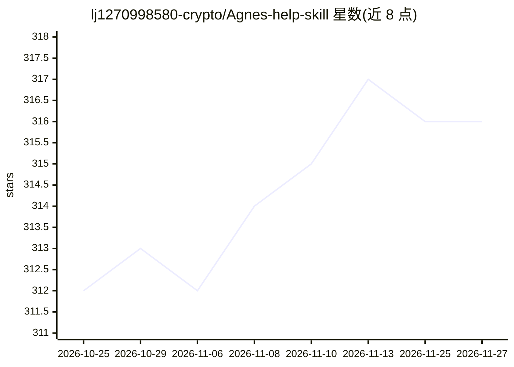

# lj1270998580-crypto/Agnes-help-skill

⭐ 316 · HTML · 推送 2026-11-26 · [GitHub](https://github.com/lj1270998580-crypto/Agnes-help-skill) · [官网](https://ailabing.cn/tools/agnes-creative-space/) · 个人维护 · 中文 README

**Agnes AI 全模态 API 的非官方文档与 Agent 支持 Skill**

面向接入 Agnes AI API 的开发者与 Agent 工具用户，提供两份核心文件：整合官方内容的完整 API 文档（带版本号）与可放入 Skill 目录的 SKILL.md。Skill 加载时自动检查 GitHub 最新 commit 提示更新；内容覆盖文本、图像、视频三模态模型的端点、参数、定价、RPM 与订阅体系，并随官方公告持续同步模型上线/下线状态。维护者为个人，声明为非官方资源。

## 筛选速览

| 维度 | 判定 | 备注 |
|---|---|---|
| AI 角色 | `ai-knowledge` | 知识聚合/清单类 |
| 许可风险 | `none` | — |
| 部署形态 | `None` |  |
| 模型依赖 | — | README 未给出锁定关系 |
| 硬件要求 | — | 无带数字的原话,不猜 |
| 安装摩擦 | `low` | 无编译、无系统依赖或容器化 |
| 成熟度 | — | 结构信号不足 |

## 能力要点

- SKILL.md 兼容 OpenClaw/Claude Code/Codex/Hermes 等 9 个工具，加载时自动检查更新
- 文档覆盖三端点（Chat Completions/Responses/Anthropic 兼容 Messages）与 Thinking 模式
- 持续同步官方模型上下线、定价与 RPM 调整（v1.3.6–v1.3.13）
- 提供 Base URL、认证头与模型名称速记

## 适用场景

- 让 Agent 自动指导接入 Agnes AI 并诊断 401/429 等错误
- 排查视频生成排队与图像生成失败问题
- 查询模型定价、RPM 限制与订阅配额

## 场景标签

 · 领域:AI API 文档/知识资源

## 证据(README 行号)

> L7: 本仓库是 Agnes AI API 的**非官方帮助资源集合**，包含完整 API 文档与通用支持 Skill，帮助开发者快速接入 Agnes AI 全模态 API（文本、图像、视频）。
> L50: |`agnes-ai-api-documentation.md`|完整 API 文档|整合官方全部接口信息，供 Agent 读取（**带版本号**）|
> L51: |`SKILL.md`|通用支持 Skill|兼容 OpenClaw / Claude Code / Claude Desktop / Hermes / Codex / WorkBuddy / Cherry Studio / Op

## 星数曲线

2026-10-25 312 → 2026-11-27 316（+4）

---
*卡片 v1 · prompt 1.4 · 生成 2026-11-27 · 置信度 high · 依据 README sha `733e2d8808d5` · [字段定义](../../DATASET.md)*
