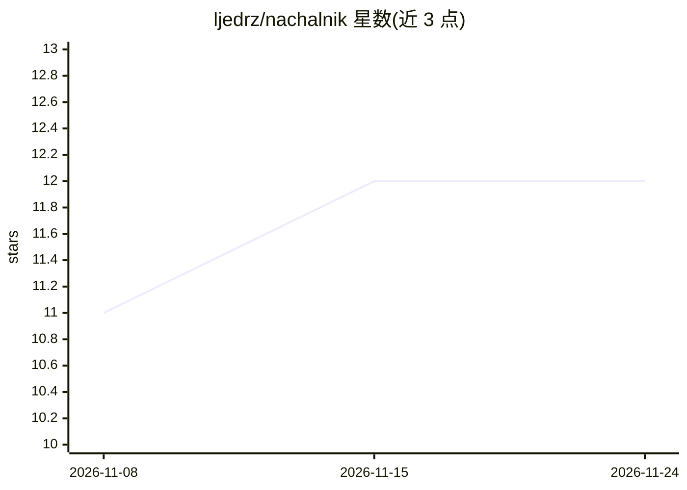

# ljedrz/nachalnik

⭐ 12 · Rust · MIT · 推送 2026-11-20 · [GitHub](https://github.com/ljedrz/nachalnik) · 个人维护

**面向开发者的显式状态 agent 运行时与终端 agent**

以 Rust 工作区形式提供：核心 crate `nachalnik` 是一个 agent 运行时，将上下文、工具、权限与请求作为可读取、可修改的显式状态（状态机循环与 append-only 事件日志）；`kamchatka` 是构建其上的终端 agent，提供上下文逐项查看与编辑、每次调用前的权限确认、内核级 Landlock/seccomp 沙箱与 headless 模式；另有 MCP 桥接 crate 与模型自省基准 crate。模型接入通过 OpenAI 兼容端点及 Gemini/Anthropic/OpenAI Responses 三种 API 方言。沙箱依赖 Linux，`kamchatka` 仅限 Linux 运行。

## 筛选速览

| 维度 | 判定 | 备注 |
|---|---|---|
| AI 角色 | `ai-ecosystem` | LLM/agent 周边工具 |
| 许可风险 | `permissive` | MIT |
| 部署形态 | `library` | 以包/库形式分发 |
| 模型依赖 | local-ok | 支持本地模型 |
| 硬件要求 | — | 无带数字的原话,不猜 |
| 安装摩擦 | `low` | 无编译、无系统依赖或容器化 |
| 成熟度 | — | 结构信号不足 |

## 能力要点

- 上下文、工具、权限与请求作为显式状态，可逐项查看、修改与撤销
- 命令在 Landlock/seccomp 内核沙箱中运行，网络访问需确认
- 支持 OpenAI 兼容本地服务器（llama.cpp/ollama/vLLM/LM Studio）与三种官方 API 方言
- 提供 nachalnik-mcp 桥接外部 MCP 服务器工具与 nachalnik-eval 自省基准

## 适用场景

- 在终端中以可控权限运行 agent 执行代码任务
- 逐项查看与编辑发送给模型的上下文内容
- 以 headless 模式批量驱动 agent 会话
- 为 agent 服务器接入外部 MCP 工具

## 场景标签

`Agent 框架` `编码 Agent` · 领域:Agent 开发

## 证据(README 行号)

> L7: **An agent runtime in which the context, the tools, the permissions and the requests are explicit
> L13: To run an agent, use `kamchatka`. To build one, use the runtime
> L107: |**`kamchatka`**|a terminal agent built on the runtime — the thing you actually run, with a confined shell, a perm

## 星数曲线

2026-11-08 11 → 2026-11-24 12（+1）

---
*卡片 v1 · prompt 1.4 · 生成 2026-11-18 · 置信度 high · 依据 README sha `f3f63ab2d0f9` · [字段定义](../../DATASET.md)*
