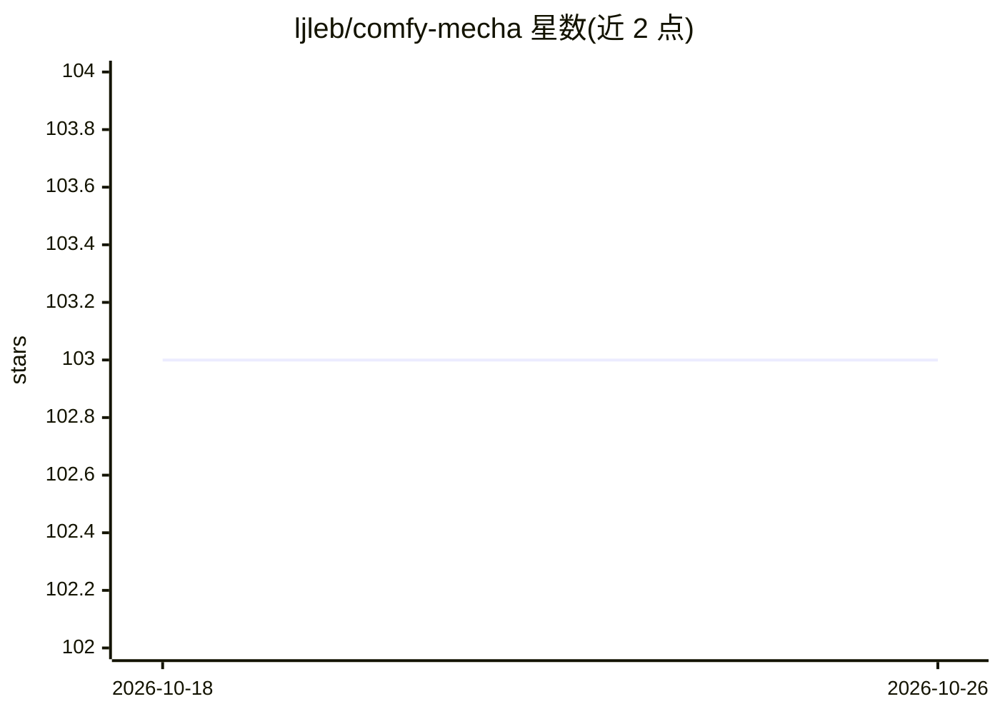

# ljleb/comfy-mecha

⭐ 103 · Python · MIT · 推送 2026-07-27 · [GitHub](https://github.com/ljleb/comfy-mecha) · 个人维护

**ComfyUI 模型合并节点包：低内存执行合并配方**

基于 sd-mecha 库的 ComfyUI 自定义节点包，用于 Stable Diffusion 模型与 LoRA 的合并：以节点方式组装复杂合并配方（加权求和、clipped add difference、TIES 等），支持块级权重（block weighted）与逐块参数设置，中间合并结果无需落盘，以低内存占用为设计目标。提供配方序列化/反序列化节点与 mecha_extensions 扩展 API，可在 mecha_extensions 目录放置 Python 脚本定义自定义合并节点；扩展 API 文档尚未完成。通过 ComfyUI-Manager 或手动 git clone 安装。

## 筛选速览

| 维度 | 判定 | 备注 |
|---|---|---|
| AI 角色 | `ai-ecosystem` | LLM/agent 周边工具 |
| 许可风险 | `permissive` | MIT |
| 部署形态 | `library` | 以包/库形式分发 |
| 模型依赖 | — | README 未给出锁定关系 |
| 硬件要求 | — | 无带数字的原话,不猜 |
| 安装摩擦 | `low` | 无编译、无系统依赖或容器化 |
| 成熟度 | — | 结构信号不足 |

## 能力要点

- 节点式组装复杂合并配方，中间结果无需保存到磁盘
- 支持模型合并与 LoRA 合并到模型，支持块级权重
- 配方可序列化/反序列化（mecha 格式）
- mecha_extensions 扩展 API 支持自定义合并节点

## 适用场景

- 在 ComfyUI 工作流中合并多个 Stable Diffusion 模型或 LoRA
- 用块级权重精细控制各块的合并参数
- 将合并配方保存为文本并在其他工作流复用

## 场景标签

 · 领域:图像生成/模型工具

## 证据(README 行号)

> L3: # sd-mecha for Comfyui
> L5: comfy-mecha is a complete model merging nodepack for ComfyUI with a focus on low memory footprint.

## 星数曲线

2026-10-18 103 → 2026-10-26 103（+0）

---
*卡片 v1 · prompt 1.4 · 生成 2026-10-23 · 置信度 mid · 依据 README sha `44b0ffb408da` · [字段定义](../../DATASET.md)*
