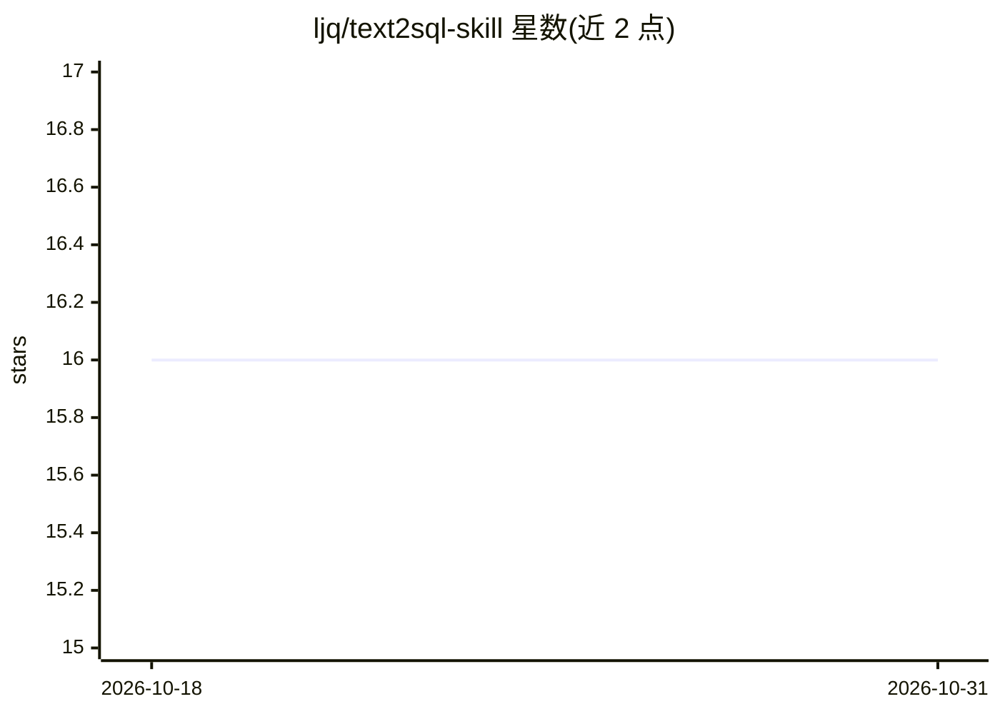

# ljq/text2sql-skill

⭐ 16 · Go · Apache-2.0 · 推送 2026-01-07 · [GitHub](https://github.com/ljq/text2sql-skill) · [官网](https://www.wdft.com) · 个人维护 · 中文 README

**面向 AI Agent 的企业级 Text-to-SQL 技能引擎**

Go 编写并从源码构建的 Text-to-SQL 技能引擎，将自然语言查询转换为带安全防护的 SQL 并执行：五层防护体系（语义分析、权限控制、执行控制、schema 演化、审计日志）、只读模式、LRU/FIFO/LFU 缓存与异步处理，支持 MySQL 与 PostgreSQL。通过 MCP 协议（JSON-RPC，含 token 认证）向 AI Agent 提供标准化工具集成。运行需 Go 1.21+、数据库及约 1GB 内存。

## 筛选速览

| 维度 | 判定 | 备注 |
|---|---|---|
| AI 角色 | `ai-native` | 本体是模型或模型工具 |
| 许可风险 | `permissive` | Apache-2.0 |
| 部署形态 | `None` |  |
| 模型依赖 | — | README 未给出锁定关系 |
| 硬件要求 | — | 无带数字的原话,不猜 |
| 安装摩擦 | `low` | 无编译、无系统依赖或容器化 |
| 成熟度 | — | 结构信号不足 |

## 能力要点

- 自然语言转 SQL，五层安全防护与审计日志
- MCP 协议服务器（text2sql/execute 等 4 个方法，token 认证）
- 支持 MySQL 与 PostgreSQL，含缓存/连接池/异步批处理
- 只读执行模式与资源限额（内存、行数、结果大小）

## 适用场景

- 为 BI 助手或数据分析 Agent 提供安全的数据查询工具
- 企业环境中通过审计日志与权限控制约束 Agent 的 SQL 访问
- 经 MCP 协议将自然语言查询接入现有 Agent 框架

## 场景标签

`数据分析` · 领域:效率与自动化

## 证据(README 行号)

> L7: * A production-ready, secure, and high-performance Text-to-SQL skill engine for enterprise applications. Convert nat
> L9: * The purpose of developing this project is to provide a relatively reliable enterprise-level Text2SQL solution for 
> L253: Text2SQL Skill Engine supports the Model Context Protocol (MCP) for standardized AI tool integration:

## 星数曲线

2026-10-18 16 → 2026-10-31 16（+0）

---
*卡片 v1 · prompt 1.4 · 生成 2026-10-30 · 置信度 mid · 依据 README sha `e9b5f2ebe46f` · [字段定义](../../DATASET.md)*
