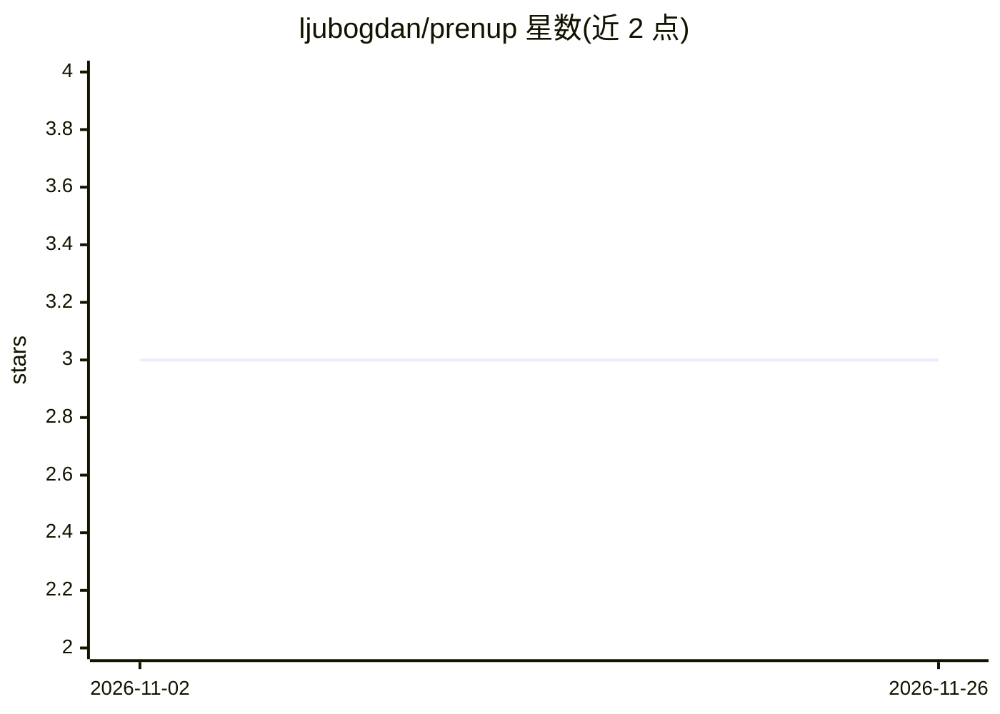

# ljubogdan/prenup

⭐ — · [GitHub]() · 个人维护

**为科研-企业合作预协商条款的多 Agent 匹配系统**

基于 Mozaik 运行时构建的多 Agent 系统：Analyst 将企业挑战转为研究问题，BM25 检索候选研究者，fit review 与 plan review 层层筛选，双方 Agent 预先协商 IP、发表审查、排他性等条款，Critic 对每句声明做逐词引用核查，无合适匹配时输出拒绝报告。三个 matchmaker 在共享看板上以版本检查写入竞争研究者资源，冲突由 Arbiter 引证裁决。新任务需 Anthropic key，已录制的回答可离线重放。

## 筛选速览

| 维度 | 判定 | 备注 |
|---|---|---|
| AI 角色 | `ai-native` | 本体是模型或模型工具 |
| 许可风险 | `permissive` | — |
| 部署形态 | `library` | 以包/库形式分发 |
| 模型依赖 | — | README 未给出锁定关系 |
| 硬件要求 | — | 无带数字的原话,不猜 |
| 安装摩擦 | `low` | 无编译、无系统依赖或容器化 |
| 成熟度 | `idea` | |

## 能力要点

- 双方 Agent 预协商条款，用户可在看板上编辑并批准/拒绝每项提议
- Critic 逐句核查引用：记录存在、原文逐字、按 id 归属、数字有出处
- matchmaker 版本检查写入竞争，Arbiter 在不知写入顺序的情况下裁决冲突
- npm run demo -- --replay 无需 API key 离线重放全部模型回答

## 适用场景

- 演示多 Agent 并发协作、事件驱动与共享状态冲突处理
- 体验科研与企业合作前的条款预协商流程
- 检验带引用的事实核查机制对虚假声明的拦截效果

## 场景标签

`多智能体` · 领域:Agent 开发

## 证据(README 行号)

> L12: **Agents that find researcher-company pairs in the EINSTEIN network, pre-negotiate the terms that usually stall col
> L25: - **The concurrency is real and measured.** Matchmakers race for researchers on a shared board with version-checked

## 星数曲线

2026-11-02 3 → 2026-11-26 3（+0）

---
*卡片 v1 · prompt 1.4 · 生成 2026-11-21 · 置信度 high · 依据 README sha `a56273776528` · [字段定义](../../DATASET.md)*
