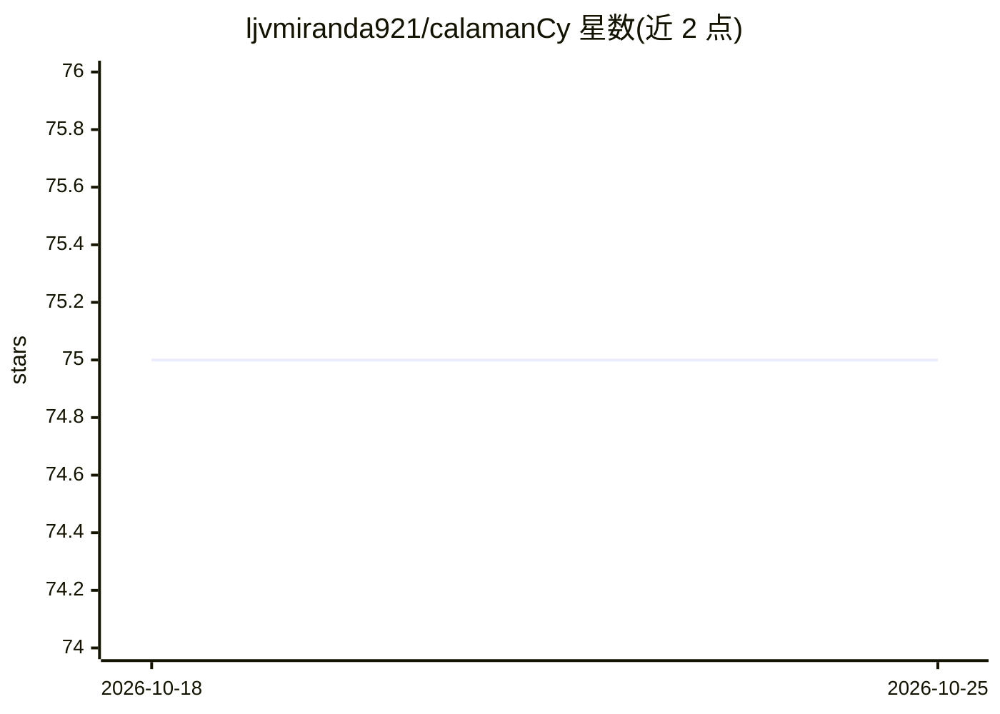

# ljvmiranda921/calamanCy

⭐ 75 · Python · MIT · 推送 2026-10-05 · [GitHub](https://github.com/ljvmiranda921/calamanCy) · [官网](https://ljvmiranda921.github.io/calamanCy/) · 个人维护

**面向他加禄语（Tagalog）的 spaCy NLP 工具包与模型库**

基于 spaCy 构建的他加禄语自然语言处理框架，提供模型（md/lg CPU 优化、trf GPU 优化 transformer 版）与数据集，支持命名实体识别（PER/ORG/LOC）、词性标注与依存句法分析。模型托管于 Hugging Face，通过 pip 安装库并用 calamancy.load() 下载加载，返回标准 spaCy pipeline；另提供面向不熟悉 spaCy 用户的轻量推理封装类。训练需遵循 spaCy 标准训练流程，仓库附论文与结果复现材料。

## 筛选速览

| 维度 | 判定 | 备注 |
|---|---|---|
| AI 角色 | `ai-native` | 本体是模型或模型工具 |
| 许可风险 | `permissive` | MIT |
| 部署形态 | `library` | 以包/库形式分发 |
| 模型依赖 | — | README 未给出锁定关系 |
| 硬件要求 | — | 无带数字的原话,不猜 |
| 安装摩擦 | `low` | 无编译、无系统依赖或容器化 |
| 成熟度 | — | 结构信号不足 |

## 能力要点

- 三种预训练模型：md/lg（CPU 优化）与 trf（GPU 优化 transformer）
- NER、POS 标注、依存句法分析任务支持
- 模型托管于 Hugging Face，calamancy.load() 一行加载
- 附轻量推理 API（EntityRecognizer/Tagger/Parser）

## 适用场景

- 对他加禄语文本做命名实体识别或句法分析
- 在 spaCy 管道中接入他加禄语处理能力
- 复现论文结果或在其数据集上开展低资源语言研究

## 场景标签

 · 领域:NLP/计算语言学

## 证据(README 行号)

> L7: **calamanCy** is a Tagalog natural language preprocessing framework made with
> L125: |tl_calamancy_md (73.7 MB)|tok2vec, tagger, morphologizer, parser, ner|CPU-optimized Tagalog NLP model. Pretrained
> L183: #### method `EntityRecognizer.__call__`

## 星数曲线

2026-10-18 75 → 2026-10-25 75（+0）

---
*卡片 v1 · prompt 1.4 · 生成 2026-10-24 · 置信度 high · 依据 README sha `41920696af46` · [字段定义](../../DATASET.md)*
