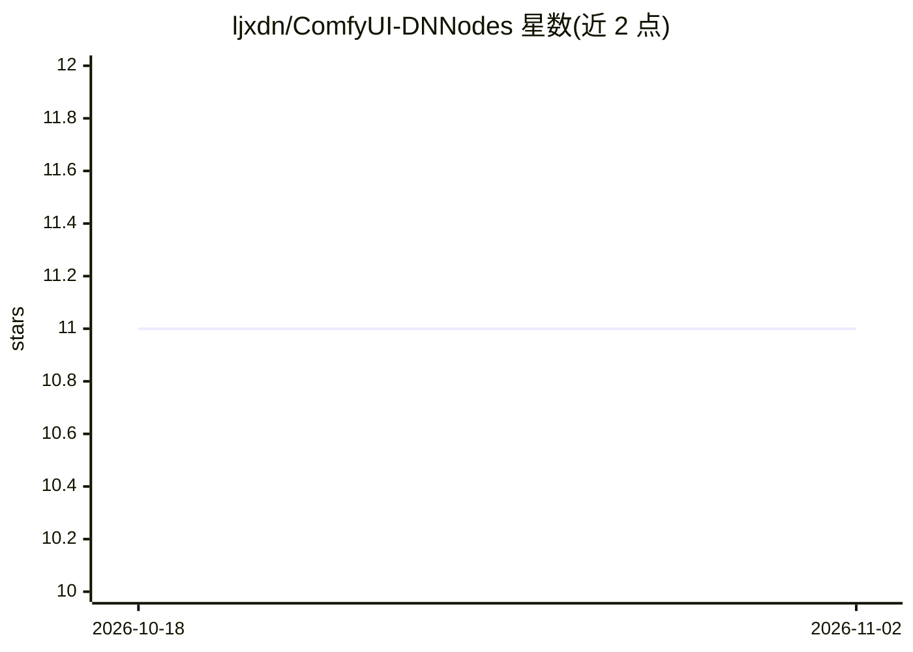

# ljxdn/ComfyUI-DNNodes

⭐ 11 · JavaScript · NOASSERTION · 推送 2026-10-29 · [GitHub](https://github.com/ljxdn/ComfyUI-DNNodes) · 个人维护 · 中文 README

**MiniMax H3 视频工作流的 ComfyUI 自定义节点包（资产卡/任务台/缓存采样）**

面向 MiniMax H3 视频生成的五个 ComfyUI 自定义节点：资产卡节点聚合图/音/描述素材，打包节点把多张卡组合为导演台 Reference-to-Video 分组，拆分节点把分组还原为官方工作流的逐口接线，任务台节点把多段汇到一处按顺序批量运行，SelfLift Sampler DN 把一采/二采拆开并按指纹落盘缓存以便跳过一采重跑。附带提示词富文本编辑器、连线高亮等前端体验。安装方式为 git clone 到 custom_nodes，无需额外 pip 包；部分节点依赖可选的兄弟包（导演台、comfyui-SelfLift），缺失时对应节点不注册。MIT 许可，资产卡部分派生自已删除的上游仓库。

## 筛选速览

| 维度 | 判定 | 备注 |
|---|---|---|
| AI 角色 | `ai-ecosystem` | LLM/agent 周边工具 |
| 许可风险 | `none` | NOASSERTION |
| 部署形态 | `None` |  |
| 模型依赖 | — | README 未给出锁定关系 |
| 硬件要求 | — | 无带数字的原话,不猜 |
| 安装摩擦 | `low` | 无编译、无系统依赖或容器化 |
| 成熟度 | — | 结构信号不足 |

## 能力要点

- 资产卡把图/音/描述聚合为单一素材单元，可打包为导演台分组
- 资产卡任务台多段汇总、按面板顺序逐段运行，下游只接一次线
- SelfLift 一采结果按指纹（种子/提示词/素材/底模）落盘缓存，同参数跳过一采
- 提示词富文本编辑器：缩略图芯片、对话块着色、镜头徽章

## 适用场景

- 把多角色图音素材整理成资产卡，批量生成 MiniMax H3 分段视频
- 多段共用一条采样链，按顺序逐段跑并各自隔离缓存
- 一采低分辨率跑一次，之后复用缓存按不同尺寸二采出片

## 场景标签

`视频生成` · 领域:内容生成

## 证据(README 行号)

> L3: 给 **MiniMax H3** 视频工作流用的五个 ComfyUI 自定义节点：把「一张资产卡（图 / 音 / 描述）」
> L19: |**SelfLift Sampler DN**|`DNSSelfLiftH3`|SelfLift 渐进采样的封装：**一采（低分辨率前缀）/ 二采（提升 + 全分辨率收尾）可以分开跑**，一采结果按指纹落盘缓存，下次同参数**跳
> L45: 资产卡 ×5 ─► 资产卡镜头打包 ×2 ─► 资产卡任务台 ─► 资产卡Group拆分 ─► SelfLift Sampler DN ─► 出片

## 星数曲线

2026-10-18 11 → 2026-11-02 11（+0）

---
*卡片 v1 · prompt 1.4 · 生成 2026-11-02 · 置信度 high · 依据 README sha `89ed053b1803` · [字段定义](../../DATASET.md)*
