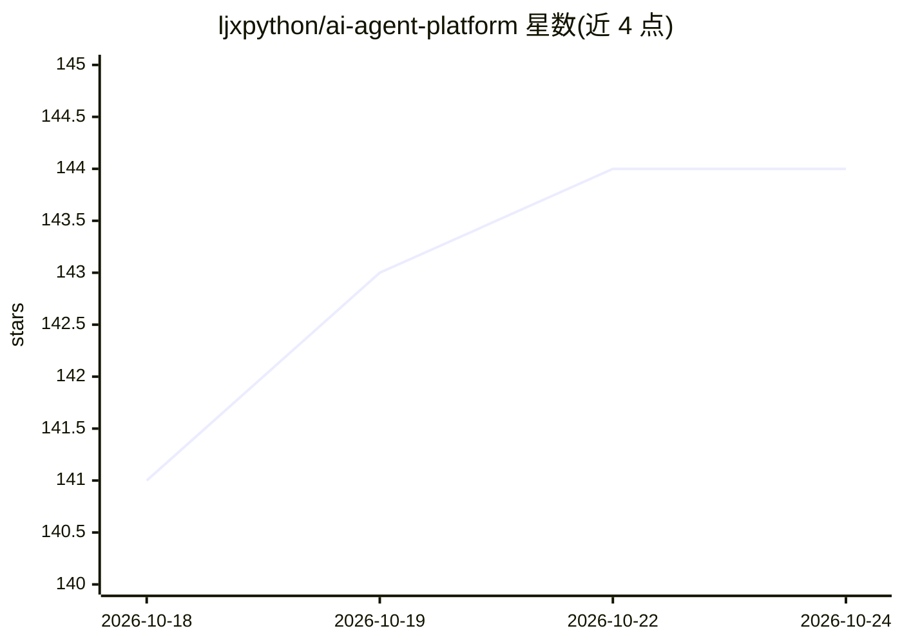

# ljxpython/ai-agent-platform

⭐ 144 · Python · 推送 2026-10-23 · [GitHub](https://github.com/ljxpython/ai-agent-platform) · 个人维护 · 中文 README

**供企业二次开发的开源 AI Agent 平台底座**

基于 LangGraph/LangChain 生态二次开发的 AI Agent 平台底座，由 Platform API（FastAPI 认证鉴权/多租户/审计/模型目录）、Platform Web（Vue 3 控制台前端）与 Runtime Service（LangGraph 图编排、工具与 MCP 装配、SSE 流式推送）三层组成。内置教学示例 showcase_demo 与生产级 DeerFlow Agent 两套智能体，提供沙箱工作区、长期记忆、HITL 审批、交互式终端等机制。预留自定义 Agent 图、Tools、MCP 服务与 Skills 扩展点供企业二开。运行需 Python 3.11+、Node.js 18+、PostgreSQL 与 Redis。

## 筛选速览

| 维度 | 判定 | 备注 |
|---|---|---|
| AI 角色 | `ai-ecosystem` | LLM/agent 周边工具 |
| 许可风险 | `none` | — |
| 部署形态 | `self-host` | docker 或自建部署 |
| 模型依赖 | — | README 未给出锁定关系 |
| 硬件要求 | — | 无带数字的原话,不猜 |
| 安装摩擦 | `low` | 无编译、无系统依赖或容器化 |
| 成熟度 | — | 结构信号不足 |

## 能力要点

- 平台治理层与 Agent 执行层解耦，经受管契约通信
- 内置 showcase_demo 教学智能体与 DeerFlow Agent 生产级智能体
- 支持 MCP 服务接入、自定义 Tools、Agent 图与 Skills 扩展点
- 提供本地多进程与 Docker Compose 两种启动方式

## 适用场景

- 企业以该底座为模板快速搭建私有 AI Agent 平台
- 基于 LangGraph 编排自有业务 Agent 图与工具
- 需要沙箱工作区、长期记忆与 HITL 审批的 Agent 生产落地

## 场景标签

`Agent 框架` `Agent 记忆` · 领域:Agent 开发

## 证据(README 行号)

> L31: 本项目为解决这一痛点而生，提供一个**可直接用于二次开发、快速搭建企业私有 AI Agent 平台**的工程底座：
> L34: - **拥抱主流开源生态，不造封闭轮子**：全面基于 `LangGraph / LangChain` 系列生态设计，深度吸收 `open-swe`、`deepagents` 与 `deer-flow` 的工程思想，原生支持复杂图编

## 星数曲线

2026-10-18 141 → 2026-10-24 144（+3）

---
*卡片 v1 · prompt 1.4 · 生成 2026-10-22 · 置信度 high · 依据 README sha `42dbb1a4a274` · [字段定义](../../DATASET.md)*
