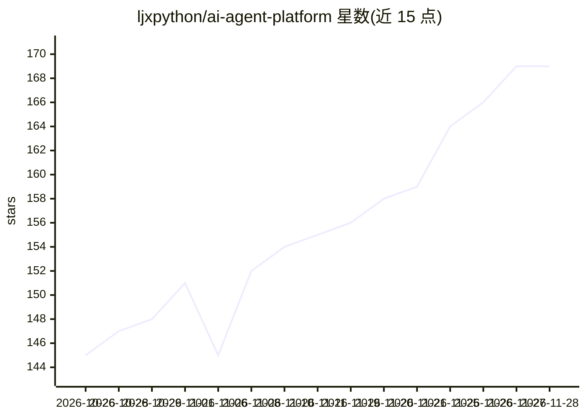

# ljxpython/ai-agent-platform

⭐ 169 · Python · 推送 2026-11-25 · [GitHub](https://github.com/ljxpython/ai-agent-platform) · 个人维护 · 中文 README

**企业二次开发自建 AI Agent 平台的工程底座**

基于 LangGraph 生态二次开发的 AI Agent 平台底座，面向需要搭建企业私有 Agent 平台的团队。系统分为平台控制面（FastAPI + PostgreSQL，负责认证鉴权、RBAC、审计、模型 Catalog）与运行时执行面（LangGraph 状态机 + Redis），通过短时委托 JWT 通信；配套 Vue 3 管理控制台、LightRAG 知识中台、MLflow/Langfuse 可观测中心与基于 EvalFlow 的持续评测飞轮。内置三套示例智能体与 20+ 技能矩阵。要求 Python 3.11+、Node.js 18+、PostgreSQL 14+、Redis 6.0+。

## 筛选速览

| 维度 | 判定 | 备注 |
|---|---|---|
| AI 角色 | `ai-ecosystem` | LLM/agent 周边工具 |
| 许可风险 | `none` | — |
| 部署形态 | `self-host` | docker 或自建部署 |
| 模型依赖 | — | README 未给出锁定关系 |
| 硬件要求 | — | 无带数字的原话,不猜 |
| 安装摩擦 | `low` | 无编译、无系统依赖或容器化 |
| 成熟度 | — | 结构信号不足 |

## 能力要点

- 平台治理与 Agent 运行时解耦，60 秒受管委托凭证通信
- 上下文防爆体系：溢出落盘、历史视口虚拟折叠、Token 预算软停机
- 内置教学 Demo、DeerFlow Agent 与平台运维排障助手三套智能体
- 真实业务会话一键转评测集的持续评测飞轮

## 适用场景

- 为企业搭建私有 AI Agent 平台作为二开模板
- 治理多租户、多项目的 Agent 运行与审计
- 对生产环境的 Agent 会话持续构建评测集

## 场景标签

`Agent 框架` `多智能体` `LLM 可观测性` `模型评测` · 领域:Agent 开发

## 证据(README 行号)

> L37: 本项目为解决这一痛点而生，提供一个**可直接用于二次开发、快速搭建企业私有 AI Agent 平台**的工程底座：
> L40: - **拥抱主流开源生态，不造封闭轮子**：全面基于 `LangGraph / LangChain` 系列生态设计，深度吸收 `open-swe`、`deepagents` 与 `deer-flow` 的工程思想，原生支持复杂图编
> L52: |**Runtime Service**|`apps/runtime-service`|**Agent 执行引擎**：LangGraph 图注册、工具与 MCP 装配、会话调度、六大防爆中间件、SSE 事件流保活推送|Python

## 星数曲线

2026-10-26 145 → 2026-11-28 169（+24）

---
*卡片 v1 · prompt 1.4 · 生成 2026-11-27 · 置信度 high · 依据 README sha `71a3eff73e06` · [字段定义](../../DATASET.md)*
