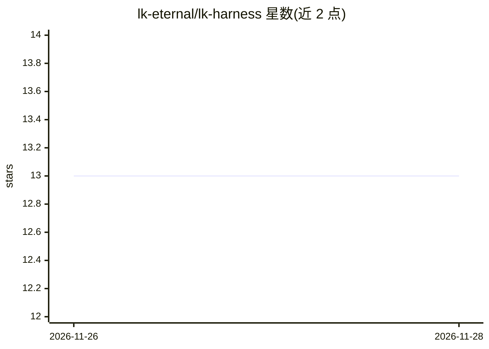

# lk-eternal/lk-harness

⭐ 13 · TypeScript · 推送 2026-11-26 · [GitHub](https://github.com/lk-eternal/lk-harness) · [官网](https://lk-ai.top/harness) · 个人维护 · 中文 README

**桌面 Agent 宿主：让本地 Agent 经飞书/微信/手机随时受指挥**

Electron 桌面应用，在本机目录与仓库中运行 Agent，应用负责消息投递、重试、打断、续聊、会话调度与定时任务；提供应用内对话、Android 手机端、飞书、微信四个入口接入同一会话。引擎可接 Cursor SDK 或多家大模型 API 及自定义兼容网关。内置 22 个 MCP 工具、文件预览面板、项目模板与访客权限控制。需电脑开机运行；macOS 版未经公证，预览不支持 pptx 等旧格式。

## 筛选速览

| 维度 | 判定 | 备注 |
|---|---|---|
| AI 角色 | `ai-ecosystem` | LLM/agent 周边工具 |
| 许可风险 | `permissive` | — |
| 部署形态 | `desktop` | 安装包/桌面程序 |
| 模型依赖 | — | README 未给出锁定关系 |
| 硬件要求 | — | 无带数字的原话,不猜 |
| 安装摩擦 | `low` | 无编译、无系统依赖或容器化 |
| 成熟度 | — | 结构信号不足 |

## 能力要点

- 应用内、手机、飞书、微信四入口进入同一条会话
- 消息至少投递一次，Agent 异常退出后未确认消息重投
- 内置 22 个 MCP 工具，支持 AI 自排程与会话记忆
- 引擎可换：Cursor SDK、多家大模型 API 或自定义兼容网关

## 适用场景

- 离开电脑时通过飞书或微信继续指挥电脑上的 Agent
- 用手机远程查看 Agent 进度、预览产出文件
- 给 Agent 配置定时任务和自动排程做周期性工作

## 场景标签

`AI 助手` · 领域:对话与助手

## 证据(README 行号)

> L10: LK Harness 是装在你电脑上的桌面应用。Agent 在你自己的目录和仓库里干活；你在应用内对话页、手机、飞书或微信里发一句话就能指挥它，过程实时回传，要拿主意时点一下就继续。
> L24: - **引擎可换。** 接 Cursor SDK，或 OpenAI、Anthropic、DeepSeek 等大模型 API，或自定义的兼容网关。
> L25: - **宿主管流程，AI 管干活。** 消息投递、重试、打断、续聊由应用的代码保证，不靠提示词。

## 星数曲线

2026-11-26 13 → 2026-11-28 13（+0）

---
*卡片 v1 · prompt 1.4 · 生成 2026-11-26 · 置信度 high · 依据 README sha `55567c6545d3` · [字段定义](../../DATASET.md)*
