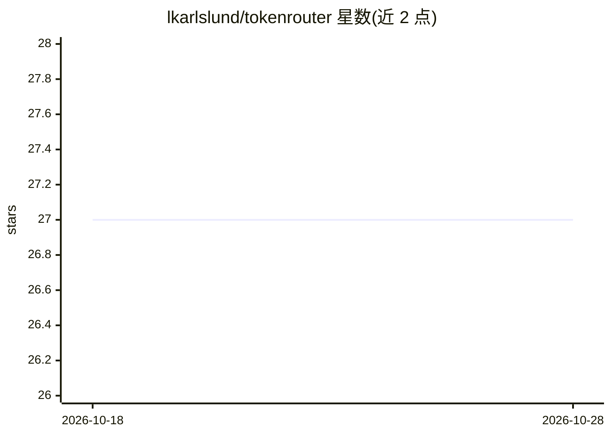

# lkarlslund/tokenrouter

⭐ 27 · Go · MIT · 推送 2026-09-23 · [GitHub](https://github.com/lkarlslund/tokenrouter) · 个人维护

**多 AI 供应商的 OpenAI 兼容统一接入网关**

用 Go 编写的 LLM API 网关：将多个 AI 供应商聚合到单一 /v1 OpenAI 兼容端点，按 provider/model 格式路由请求。提供 admin/keymaster/inferrer 三级令牌体系、临时子令牌签发（供 Codex、Opencode 等工具使用）、请求与令牌配额控制、用量统计与内置管理界面，支持 Let's Encrypt/自签名/PEM 的 TLS。安装方式为 go install 源码编译或下载预编译二进制（Linux/macOS/Windows 及 deb/rpm/archlinux 包）。

## 筛选速览

| 维度 | 判定 | 备注 |
|---|---|---|
| AI 角色 | `ai-ecosystem` | LLM/agent 周边工具 |
| 许可风险 | `permissive` | MIT |
| 部署形态 | `library` | 以包/库形式分发 |
| 模型依赖 | — | README 未给出锁定关系 |
| 硬件要求 | — | 无带数字的原话,不猜 |
| 安装摩擦 | `low` | 无编译、无系统依赖或容器化 |
| 成熟度 | — | 结构信号不足 |

## 能力要点

- 单一 OpenAI 兼容端点聚合多供应商并按 provider/model 路由
- 三级令牌体系与临时子令牌（toro CLI，可设 TTL）
- 请求/令牌配额与用量统计（延迟、TPS、按供应商/模型/密钥/IP）
- 内置管理界面与多平台预编译二进制

## 适用场景

- 多供应商环境下统一 API 端点，避免在工具中硬编码各供应商端点
- 为 Codex/Opencode 等工具签发限时临时密钥
- 在管理界面查看用量、配额与请求日志

## 场景标签

`模型网关` · 领域:Agent 开发

## 证据(README 行号)

> L3:  One OpenAI-compatible endpoint for all your AI providers.
> L20: - Plug in multiple providers and route by `provider/model`.

## 星数曲线

2026-10-18 27 → 2026-10-28 27（+0）

---
*卡片 v1 · prompt 1.4 · 生成 2026-10-26 · 置信度 high · 依据 README sha `7bcdddd2cb47` · [字段定义](../../DATASET.md)*
