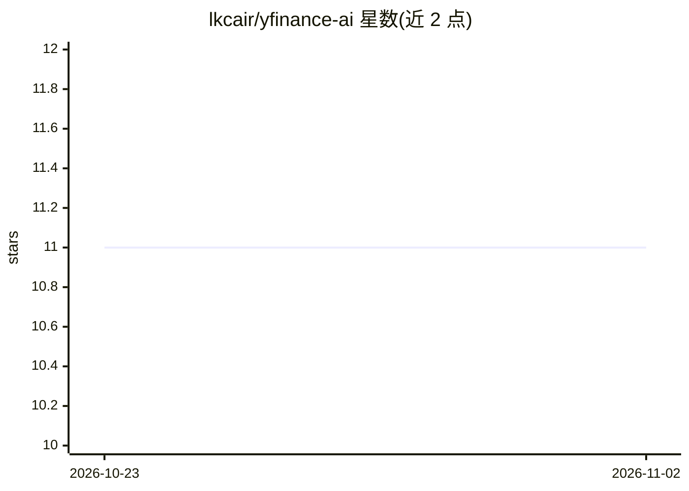

# lkcair/yfinance-ai

⭐ 11 · Python · MIT · 推送 2026-10-21 · [GitHub](https://github.com/lkcair/yfinance-ai) · 个人维护

**面向 MCP 客户端的 Yahoo Finance 数据工具集：68 个金融工具**

单文件 Python 库 yfinance_ai，封装 68 个金融数据工具：股票/ETF/基金/加密货币/外汇/大宗商品的行情与历史、财报、比率、分析师预期、股息、期权、持股人、新闻与日历等，数据经 yfinance 来自 Yahoo Finance。以 MCP 服务器（uvx yfinance-ai）、OpenClaw 技能、OpenWebUI 工具和 Python 库四种形式分发，供 Claude、Cursor、VS Code、LangChain 等 MCP 客户端调用。声明数据可能延迟、仅供研究教育用途。

## 筛选速览

| 维度 | 判定 | 备注 |
|---|---|---|
| AI 角色 | `ai-ecosystem` | LLM/agent 周边工具 |
| 许可风险 | `permissive` | MIT |
| 部署形态 | `None` |  |
| 模型依赖 | — | README 未给出锁定关系 |
| 硬件要求 | — | 无带数字的原话,不猜 |
| 安装摩擦 | `low` | 无编译、无系统依赖或容器化 |
| 成熟度 | — | 结构信号不足 |

## 能力要点

- 68 个工具覆盖行情、财报、分析师、期权、持股、日历等类别
- 四种分发形式：MCP 服务器、OpenClaw 技能、OpenWebUI 工具、Python 库
- get_complete_analysis 一键调用相关工具生成个股完整分析
- 内置 run_self_test 自检（64 项检查）

## 适用场景

- 在 Claude/Cursor 等 MCP 客户端中查询股票行情、财报与分析师预期
- 让 AI 助手对比多只股票的关键指标和历史表现
- 查询财报日历、IPO 与经济事件日历

## 场景标签

`金融量化` · 领域:学习与行业

## 证据(README 行号)

> L3: World's first AI-powered Yahoo Finance integration: 68 tools for stocks, ETFs, mutual funds, crypto, forex and commo
> L11: |Claude, Cursor, VS Code, LangChain, Google ADK, Strands Agents and other MCP clients|`uvx yfinance-ai@latest`|yfin
> L24: Setup for VS Code, Claude Desktop, Cursor and other clients, plus LangChain, Google ADK and Strands Agents examples

## 星数曲线

2026-10-23 11 → 2026-11-02 11（+0）

---
*卡片 v1 · prompt 1.4 · 生成 2026-11-02 · 置信度 high · 依据 README sha `c39ef7d7b0de` · [字段定义](../../DATASET.md)*
