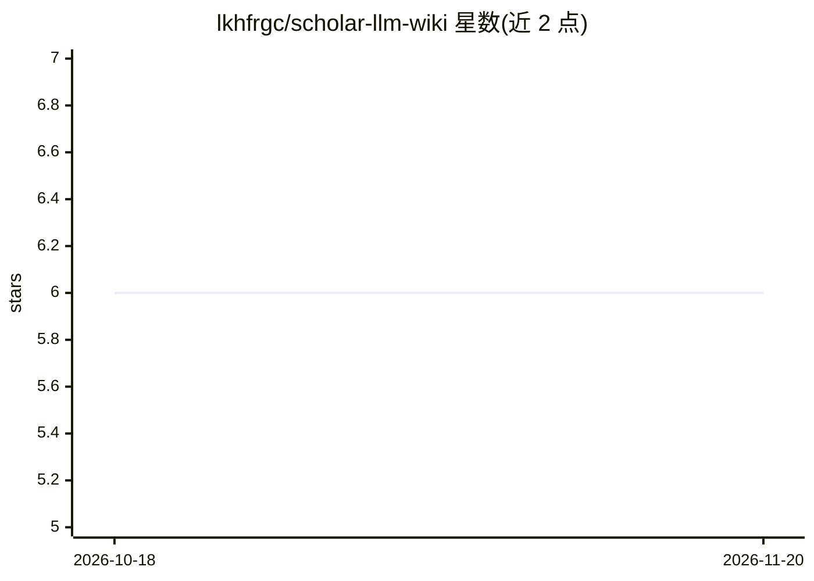

# lkhfrgc/scholar-llm-wiki

⭐ 6 · Python · MIT · 推送 2026-10-11 · [GitHub](https://github.com/lkhfrgc/scholar-llm-wiki) · 个人维护 · 中文 README

**科研文献整理工具包：AI agent 编译出 Obsidian 知识库**

基于 Karpathy llm-wiki 模式实例化的知识库工具包，面向科研与文献整理场景。由 AGENTS.md 架构契约、ingest/query/lint 三个技能与 13 个 Python 脚本组成，把论文、书籍、课件编译为结构化、高度互链的 Obsidian wiki，含论文讲解页模板、概念两级分层、Canvas 概念地图、七分面受控 tag 词表与 PDF 公式提取流水线。依赖 DSH 技能宿主触发技能、Obsidian 呈现双链与图谱；Python ≥3.9 必需，PyMuPDF 等为可选依赖。

## 筛选速览

| 维度 | 判定 | 备注 |
|---|---|---|
| AI 角色 | `ai-native` | 本体是模型或模型工具 |
| 许可风险 | `permissive` | MIT |
| 部署形态 | `desktop` | 安装包/桌面程序 |
| 模型依赖 | — | README 未给出锁定关系 |
| 硬件要求 | — | 无带数字的原话,不猜 |
| 安装摩擦 | `low` | 无编译、无系统依赖或容器化 |
| 成熟度 | — | 结构信号不足 |

## 能力要点

- ingest/query/lint 三个技能构成摄入→生成→巡检流水线
- arXiv/DOI 取 LaTeX 真值、按 bbox 裁图的 PDF 公式核对流水线
- 七分面封闭 tag 词表与退出码审计脚本，可接 CI/pre-commit
- 目录名、领域、词表全部 JSON 配置化，仓库零硬编码

## 适用场景

- 持续读论文的研究者把文献沉淀为互链知识库
- 跨几十篇文献建立概念分层与概念地图
- 用 /lint 定期巡检死链、孤儿页与过时论断
- 需要公式可靠的论文讲解页（arXiv→LaTeX 流水线）

## 场景标签

`知识库管理` `科研工具` · 领域:知识与检索

## 证据(README 行号)

> L3: > **文献进，知识出。** 面向**科研与文献整理**的知识库工具包：AI agent 把论文、书籍、课件、网页长文**编译**成结构化、高度互链的 Obsidian 知识库。
> L22: - 三个技能（`ingest` / `query` / `lint`）—— 把「摄入资料 → 生成页面 → 维护索引 → 健康巡检」固化成流水线；
> L55: |**DSH（DeepSeek Harness）**|**技能宿主**。它读取 `.dsh/skills/<name>/SKILL.md`，把 `/ingest`、`/query`、`/lint` 变成可触发的流水线；同时自动加载

## 星数曲线

2026-10-18 6 → 2026-11-20 6（+0）

---
*卡片 v1 · prompt 1.4 · 生成 2026-11-20 · 置信度 mid · 依据 README sha `524e7176f06c` · [字段定义](../../DATASET.md)*
