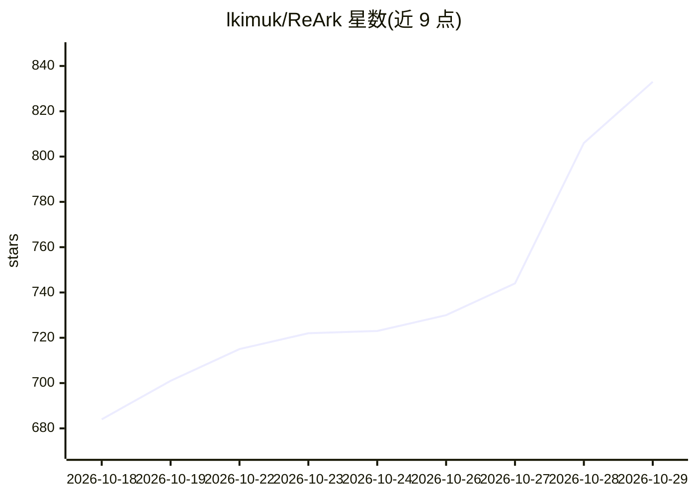

# lkimuk/ReArk

⭐ 833 · C++ · Apache-2.0 · 推送 2026-10-28 · [GitHub](https://github.com/lkimuk/ReArk) · 个人维护 · 中文 README

**多平台应用与二进制逆向分析桌面工具，含 AI 助手**

桌面端逆向工程与 AI 辅助分析工具：支持打开 HarmonyOS NEXT（hap/app/abc）、Android（apk/aab）、iOS（ipa）包及 PE/ELF/Mach-O 原生二进制，在一个工作区内查看包结构、反汇编反编译 ABC 字节码、清单权限、签名证书与安全缓解措施（ASLR/DEP/PIE/RELRO 等）。内置 ReArk Agent，可就当前包提问、检索包内证据，支持 OpenAI 兼容端点与本地 Ollama 模型；另支持通过 HDC/ADB 连接设备的安装、投屏与控制。以安装包形式分发，Linux 版待发布。

## 筛选速览

| 维度 | 判定 | 备注 |
|---|---|---|
| AI 角色 | `ai-enhanced` | 去掉 AI 部分产品仍成立 |
| 许可风险 | `permissive` | Apache-2.0 |
| 部署形态 | `desktop` | 安装包/桌面程序 |
| 模型依赖 | local-ok | 支持本地模型 |
| 硬件要求 | — | 无带数字的原话,不猜 |
| 安装摩擦 | `low` | 无编译、无系统依赖或容器化 |
| 成熟度 | — | 结构信号不足 |

## 能力要点

- HarmonyOS hap/app/abc、Android apk/aab、iOS ipa 及 PE/ELF/Mach-O 统一分析
- ABC 字节码反汇编与反编译，含字符串/交叉引用/参数流
- ReArk Agent 上下文问答，支持 OpenAI 兼容端点与本地 Ollama
- HDC/ADB 连接设备：安装、投屏、UI 节点检查与日志读取

## 适用场景

- 审阅移动应用代码、资源、权限与签名
- 分析二进制安全缓解措施与导入导出结构
- 在 CTF 挑战与安全研究中结合 AI 助手排查应用逻辑
- 通过连接设备安装应用并实时投屏控制

## 场景标签

`网络安全` · 领域:学习与行业

## 证据(README 行号)

> L5: ReArk is a desktop reverse engineering and AI-assisted analysis tool for HarmonyOS NEXT, Android, and iOS applicatio
> L46: - Ask contextual questions about the current HarmonyOS or Android package
> L49: - Use supported model providers, including OpenAI-compatible endpoints and local Ollama models

## 星数曲线

2026-10-18 684 → 2026-10-29 833（+149）

---
*卡片 v1 · prompt 1.4 · 生成 2026-10-21 · 置信度 high · 依据 README sha `c35fda740d83` · [字段定义](../../DATASET.md)*
