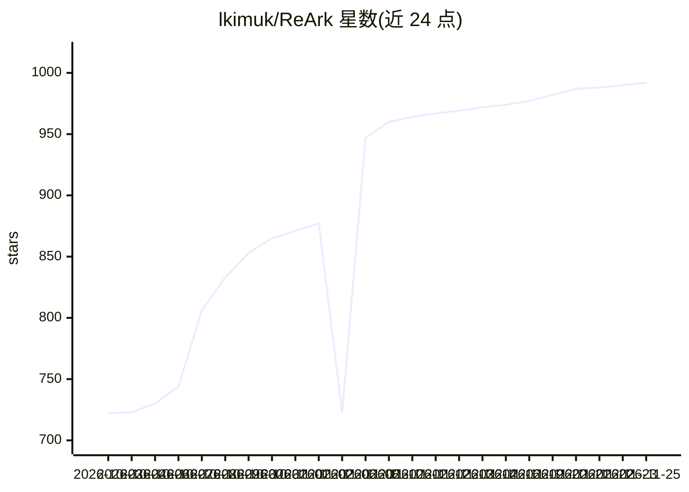

# lkimuk/ReArk

⭐ 992 · C++ · Apache-2.0 · 推送 2026-10-28 · [GitHub](https://github.com/lkimuk/ReArk) · 个人维护 · 中文 README

**面向鸿蒙/安卓/iOS 应用的逆向工程与 AI 辅助分析桌面工具**

桌面端逆向工程工具，支持打开 HarmonyOS NEXT（hap/app/abc）、Android（apk/aab）、iOS（ipa）及 PE/ELF/Mach-O 原生二进制，提供反汇编、反编译、签名/证书检查、资源与元数据浏览等静态分析。可经 HDC/ADB 连接真机做安装、截屏、UI 检查、投屏与日志读取。内置 ReArk Agent，可对当前包提问并按需检索文件、反汇编等证据，支持 OpenAI 兼容端点与本地 Ollama 模型，1.2.0 加入 Frida 动态分析与 MCP Server 集成。仅限合法授权用途，Linux 版未发布。

## 筛选速览

| 维度 | 判定 | 备注 |
|---|---|---|
| AI 角色 | `ai-enhanced` | 去掉 AI 部分产品仍成立 |
| 许可风险 | `permissive` | Apache-2.0 |
| 部署形态 | `desktop` | 安装包/桌面程序 |
| 模型依赖 | local-ok | 支持本地模型 |
| 硬件要求 | — | 无带数字的原话,不猜 |
| 安装摩擦 | `low` | 无编译、无系统依赖或容器化 |
| 成熟度 | — | 结构信号不足 |

## 能力要点

- 支持 HarmonyOS NEXT/Android/iOS/PE/ELF/Mach-O 多格式静态分析与 ABC 反编译
- ReArk Agent 上下文问答，支持 OpenAI 兼容端点与本地 Ollama 模型
- HDC/ADB 真机连接：安装、截屏、UI 检查、实时投屏与键鼠控制
- Frida 动态分析、内存转储与 APK 重打包/签名校验

## 适用场景

- 逆向分析鸿蒙 NEXT 与安卓应用的结构、签名与反编译代码
- 配合真机投屏与日志做应用行为调试
- 授权范围内的安全审计、恶意样本分析与 CTF 题目求解

## 场景标签

`网络安全` · 领域:学习与行业

## 证据(README 行号)

> L5: ReArk is a desktop reverse engineering and AI-assisted analysis tool for HarmonyOS NEXT, Android, and iOS applicatio
> L44: **ReArk Agent**
> L49: - Use supported model providers, including OpenAI-compatible endpoints and local Ollama models

## 星数曲线

2026-10-23 722 → 2026-11-25 992（+270）

---
*卡片 v1 · prompt 1.4 · 生成 2026-11-24 · 置信度 high · 依据 README sha `8fabe52f678d` · [字段定义](../../DATASET.md)*
