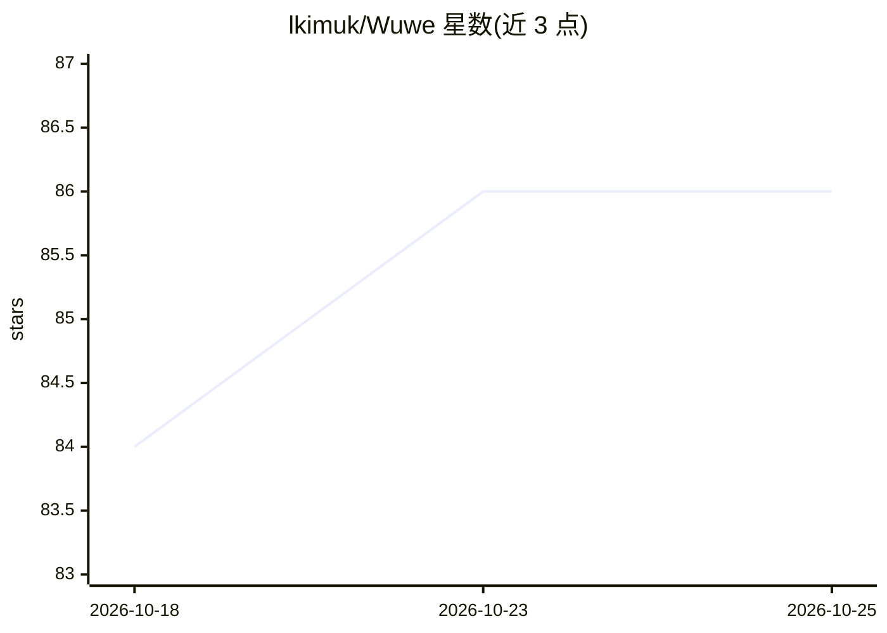

# lkimuk/Wuwe

⭐ 87 · C++ · Apache-2.0 · 推送 2026-10-22 · [GitHub](https://github.com/lkimuk/Wuwe) · 个人维护

**C++20 原生应用构建工具调用型 AI agent 的框架**

面向原生应用、服务与命令行程序的 C++20 agent 构建框架，提供可独立使用的模块：模型客户端与能力感知路由、类型化工具、Skills、规划、多 agent 协作与 A2A、编排、记忆与 RAG、护栏与评测、离线学习、MCP、审计与受控执行（受控/受限子进程后端）。构建需 CMake 3.25+、C++20 编译器与 vcpkg，各平台提供打包脚本与发布档。限制：controlled_process 非强沙箱，SQLite 知识索引用线性扫描，远程索引需宿主自行管理。

## 筛选速览

| 维度 | 判定 | 备注 |
|---|---|---|
| AI 角色 | `ai-ecosystem` | LLM/agent 周边工具 |
| 许可风险 | `permissive` | Apache-2.0 |
| 部署形态 | `None` |  |
| 模型依赖 | local-ok | 支持本地模型 |
| 硬件要求 | — | 无带数字的原话,不猜 |
| 安装摩擦 | `medium` | 含编译或系统依赖之一 |
| 成熟度 | — | 结构信号不足 |

## 能力要点

- OpenAI 兼容、Anthropic、Gemini、Ollama 客户端与能力感知路由
- A2A、多 agent 协作、类型化 fan-out/fan-in 编排
- MCP server/client/gateway 与审计、护栏、评测模块
- 受控子进程执行后端（Windows AppContainer / macOS Seatbelt）

## 适用场景

- 在 C++ 应用中集成带工具调用与记忆的 agent
- 构建需要审批与审计事件的可治理 agent 服务
- 通过 MCP 接入外部工具与远程索引

## 场景标签

`Agent 框架` `多智能体` `Agent 记忆` · 领域:Agent 开发

## 证据(README 行号)

> L24: Wuwe is a C++20 framework for building tool-using, stateful, and auditable AI agents in native applications, servic
> L26: It provides independently usable modules for model access, resource-aware routing, typed tools, reusable Skills, re

## 星数曲线

2026-10-18 84 → 2026-10-25 86（+2）

---
*卡片 v1 · prompt 1.4 · 生成 2026-10-24 · 置信度 high · 依据 README sha `5ce9a87417ba` · [字段定义](../../DATASET.md)*
