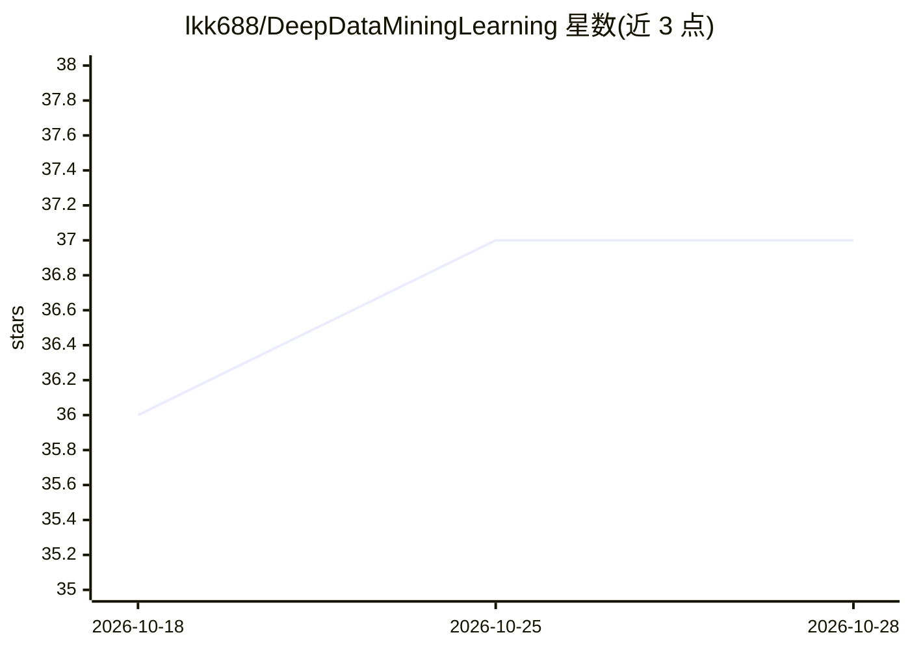

# lkk688/DeepDataMiningLearning

⭐ 37 · Jupyter Notebook · 推送 2026-10-26 · [GitHub](https://github.com/lkk688/DeepDataMiningLearning) · [官网](https://deepdatamininglearning.readthedocs.io) · 组织维护

**面向 SJSU 课程的数据挖掘/机器学习/深度学习教学代码集**

覆盖 SJSU CMPE255/257/258/249 四门课程的教学示例代码与教程合集，内容从 Python 基础、NumPy/Pandas、EDA，到 scikit-learn 经典机器学习、PyTorch 深度学习系列教程（共 10 个主题：基础、CNN、迁移学习、TIMM、推理优化、Hugging Face 集成）、多 GPU 训练、目标检测与基于 MMDetection3D 的 3D 检测/自动驾驶 pipeline，并含 LLM 与 Google Cloud/BigQuery 数据分析章节。大量示例以 Colab notebook 形式提供（部分需 SJSU Google 账号），文档托管于 ReadTheDocs，支持本地、HPC、云端多平台。

## 筛选速览

| 维度 | 判定 | 备注 |
|---|---|---|
| AI 角色 | `ai-knowledge` | 知识聚合/清单类 |
| 许可风险 | `none` | — |
| 部署形态 | `library` | 以包/库形式分发 |
| 模型依赖 | — | README 未给出锁定关系 |
| 硬件要求 | — | 无带数字的原话,不猜 |
| 安装摩擦 | `low` | 无编译、无系统依赖或容器化 |
| 成熟度 | — | 结构信号不足 |

## 能力要点

- Python 数据分析到 PyTorch 深度学习的分层教程代码
- 10 讲 PyTorch 系列：CNN/TorchVision/TIMM/TorchScript/ONNX 推理优化
- 目标检测与基于 MMDetection3D 的 LiDAR–相机 3D 检测（nuScenes/Waymo）
- Google Cloud/BigQuery 数据分析与 BigQuery ML/LLM 示例

## 适用场景

- 跟随课程或自学数据挖掘与深度学习，配套可运行 notebook
- 查找 PyTorch 训练、迁移学习与推理部署的参考实现
- 在 Colab/HPC 环境中复现图像分类与 3D 检测实验

## 场景标签

`教程课程` · 领域:学习与行业

## 证据(README 行号)

> L3: > **Comprehensive collection of data mining, machine learning, and deep learning sample codes and tutorials**
> L6: - **SJSU CMPE255** - Data Mining
> L13: - ✅ **Comprehensive tutorials** from basic Python to advanced deep learning

## 星数曲线

2026-10-18 36 → 2026-10-28 37（+1）

---
*卡片 v1 · prompt 1.4 · 生成 2026-10-25 · 置信度 mid · 依据 README sha `ea8952ffaf4c` · [字段定义](../../DATASET.md)*
