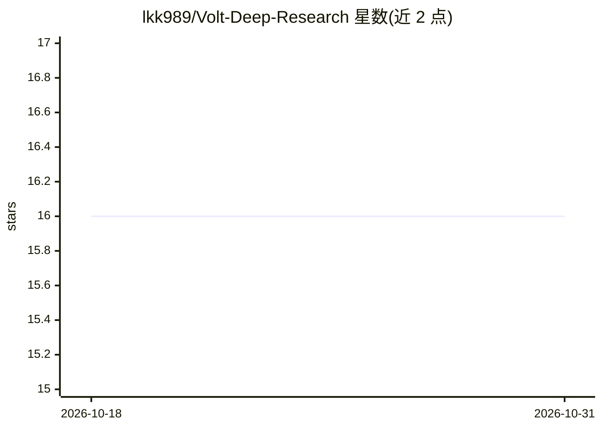

# lkk989/Volt-Deep-Research

⭐ 16 · TypeScript · MIT · 推送 2026-07-30 · [GitHub](https://github.com/lkk989/Volt-Deep-Research) · [官网](https://lkk989.github.io/Volt-Deep-Research/) · 个人维护

**基于 VoltAgent 的多智能体深度研究平台：自动完成研究与报告**

由 VoltAgent 后端、Next.js 仪表盘前端、类型化客户端层、AI 渲染组件与本地工作区运行时组成的多智能体研究系统。注册 17 个运行时 agent（研究协调、事实核查、综合、写作、编码等）与 5 个工作流，提供 30+ 后端工具模块（股票/加密市场、ArXiv、RAG、网页抓取等）、4 个工作区工具包（文件系统/搜索/沙箱/技能），使用 LibSQL 共享内存与向量检索，集成 OpenTelemetry/VoltOps 可观测性。需 Node.js 18+ 与 Google Generative AI API key，从源码克隆并以 npm 运行，后端端口 3141。

## 筛选速览

| 维度 | 判定 | 备注 |
|---|---|---|
| AI 角色 | `ai-native` | 本体是模型或模型工具 |
| 许可风险 | `permissive` | MIT |
| 部署形态 | `library` | 以包/库形式分发 |
| 模型依赖 | — | README 未给出锁定关系 |
| 硬件要求 | — | 无带数字的原话,不猜 |
| 安装摩擦 | `low` | 无编译、无系统依赖或容器化 |
| 成熟度 | — | 结构信号不足 |

## 能力要点

- 17 个运行时 agent 与 5 个注册工作流
- 30+ 后端工具/工具包模块（市场数据、RAG、抓取、代码分析等）
- LibSQL 共享内存与向量检索支持
- 工作区含路径遏制、沙箱超时与读前写保护的安全模型

## 适用场景

- 自动化完成深度研究、资料收集与报告生成
- 组织多智能体完成数据分析与事实核查流程
- 在带审批与沙箱的工作区中执行编码与评审任务

## 场景标签

`多智能体` `科研工具` `数据分析` · 领域:Agent 开发

## 证据(README 行号)

> L7: ### 🧠 Enterprise-grade multi-agent research platform powered by VoltAgent
> L24: Volt Deep Research is a production-style research system that combines a VoltAgent backend, a Next.js dashboard fro
> L30: - 🧩 synthesis and report generation

## 星数曲线

2026-10-18 16 → 2026-10-31 16（+0）

---
*卡片 v1 · prompt 1.4 · 生成 2026-10-30 · 置信度 high · 依据 README sha `b4cc394ab360` · [字段定义](../../DATASET.md)*
