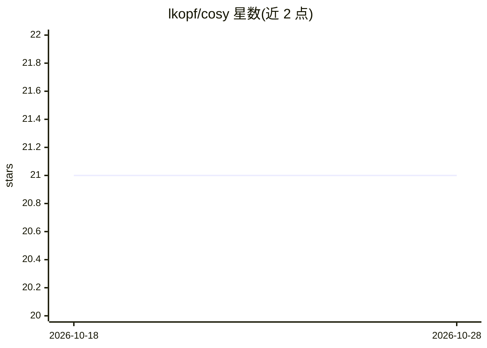

# lkopf/cosy

⭐ 21 · Jupyter Notebook · 推送 2026-01-28 · [GitHub](https://github.com/lkopf/cosy) · 组织维护

**神经元文本解释的自动评估框架（NeurIPS 2024）**

NeurIPS 2024 论文 CoSy: Evaluating Textual Explanations of Neurons 的官方代码仓库。框架名为 CoSy（Concept Synthesis），面向可解释 AI（XAI）研究：用条件生成模型根据文本解释合成数据点，比较神经元对这些数据点与对照数据点的响应以估计解释质量。支持 MILAN、FALCON、CLIP-Dissect、INVERT 等方法的解释评估，流程分三步：收集激活、生成解释图像、执行评估。需自备对照数据集（如 ImageNet/Places365），通过 requirements.txt 安装依赖，基于 PyTorch 运行。

## 筛选速览

| 维度 | 判定 | 备注 |
|---|---|---|
| AI 角色 | `ai-ecosystem` | LLM/agent 周边工具 |
| 许可风险 | `none` | — |
| 部署形态 | `library` | 以包/库形式分发 |
| 模型依赖 | — | README 未给出锁定关系 |
| 硬件要求 | — | 无带数字的原话,不猜 |
| 安装摩擦 | `low` | 无编译、无系统依赖或容器化 |
| 成熟度 | — | 结构信号不足 |

## 能力要点

- 架构无关的神经元文本解释评估框架
- 用条件生成模型合成数据点对比神经元响应
- 支持评估 MILAN/FALCON/CLIP-Dissect/INVERT 生成的解释
- 附带预计算解释与论文复现 notebook

## 适用场景

- 评估神经元文本解释方法的质量
- 复现 NeurIPS 2024 论文实验与图表
- 对新的解释方法进行基准评估

## 场景标签

`模型评测` `科研工具` · 领域:评测与运维

## 证据(README 行号)

> L5: This repository contains the code and experiments for the paper **CoSy: Evaluating Textual Explanations of Neurons**
> L11: **Evaluating Neuron Explanations** In Explainable AI (XAI) there are methods which connect neurons in Deep Neural N

## 星数曲线

2026-10-18 21 → 2026-10-28 21（+0）

---
*卡片 v1 · prompt 1.4 · 生成 2026-10-28 · 置信度 high · 依据 README sha `ab3e489e86fa` · [字段定义](../../DATASET.md)*
