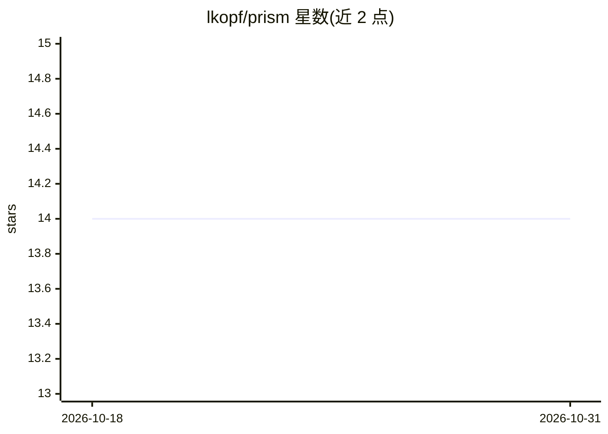

# lkopf/prism

⭐ 14 · Jupyter Notebook · 推送 2026-06-26 · [GitHub](https://github.com/lkopf/prism) · 组织维护

**多概念特征描述框架：识别并评分神经网络多义特征**

NeurIPS 2025 论文的官方代码仓库。PRISM 从最高激活百分位采样句子，在嵌入空间聚类，并用 LLM 为每个概念簇生成标签，从而对多义与单义特征给出多条人类可读描述。仓库包含特征描述脚本、基于 CoSy 分数与多义性分数（余弦相似度、max AUC、max MAD）的评测脚本、元标签生成脚本，以及复现论文表格与图表的 Jupyter notebook。安装方式为 pip install -r requirements.txt，需在 config.py 中配置参数或使用默认值。

## 筛选速览

| 维度 | 判定 | 备注 |
|---|---|---|
| AI 角色 | `ai-native` | 本体是模型或模型工具 |
| 许可风险 | `none` | — |
| 部署形态 | `library` | 以包/库形式分发 |
| 模型依赖 | — | README 未给出锁定关系 |
| 硬件要求 | — | 无带数字的原话,不猜 |
| 安装摩擦 | `low` | 无编译、无系统依赖或容器化 |
| 成熟度 | — | 结构信号不足 |

## 能力要点

- 对单个特征输出多条概念描述（百分位采样+聚类+LLM 标注）
- CoSy 分数与多义性分数（余弦相似度、max AUC、max MAD）评测
- 支持分析注意力头与神经元组的响应模式
- 提供复现论文基准表与图表的 notebook

## 适用场景

- 对 LLM 内部神经元/特征做多概念可解释性分析
- 研究模型各层与架构间多义性与可解释性的变化
- 生成并评测特征描述以复现论文实验

## 场景标签

 · 领域:机器学习可解释性研究

## 证据(README 行号)

> L5: This repository contains the code and experiments for the paper **Capturing Polysemanticity with PRISM: A Multi-Conc
> L11: Unlike prior approaches that assign a single description per feature, PRISM (Polysemantic FeatuRe Identification an

## 星数曲线

2026-10-18 14 → 2026-10-31 14（+0）

---
*卡片 v1 · prompt 1.4 · 生成 2026-10-31 · 置信度 high · 依据 README sha `3e6c3cdf29e8` · [字段定义](../../DATASET.md)*
