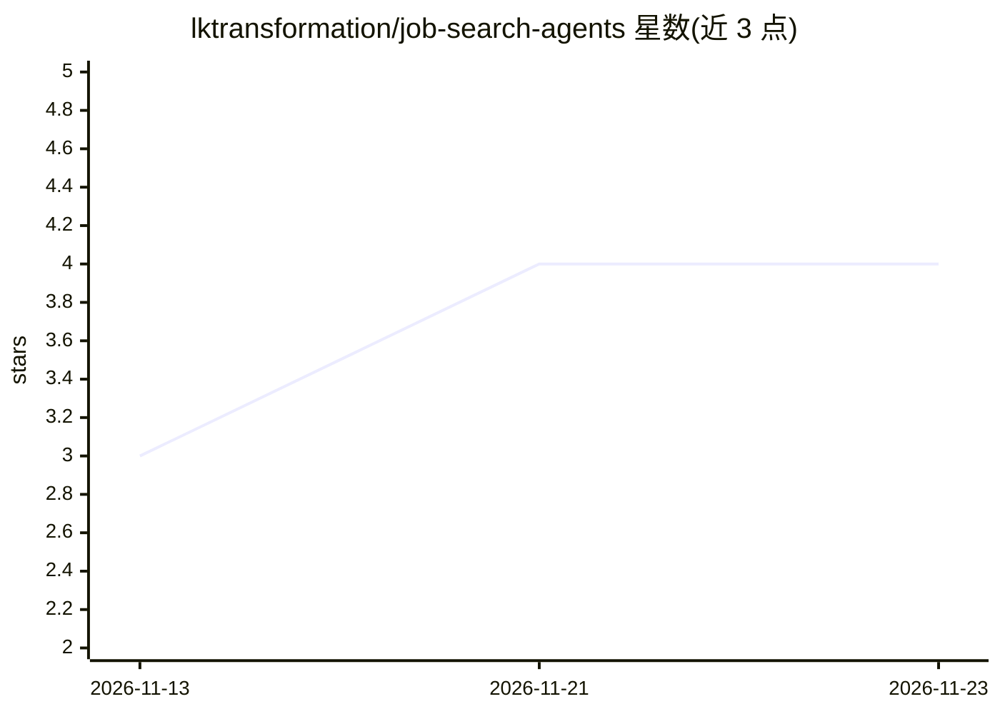

# lktransformation/job-search-agents

⭐ 4 · Python · MIT · 推送 2026-11-10 · [GitHub](https://github.com/lktransformation/job-search-agents) · 个人维护

**面向求职者的本地 AI agent：生成定制简历、求职信与面试准备材料**

包含两个本地运行的 AI agent：CV/求职信 agent 读取职位描述、调研公司并以 Word 文档输出定制简历与一页求职信；面试准备 agent 生成 1-2 页 PDF 面试速查表（匹配故事、预期问题、公司概况、薪资参考、可提问题）。仓库只含模板与提示词，不含职业数据，用户须自行创建知识文件（职业履历、故事库、风格规则）。可脱离 Claude，用复制粘贴提示词在任意 AI 聊天工具中运行；所有内容在本地生成，个人文件通过 .gitignore 防止误提交。

## 筛选速览

| 维度 | 判定 | 备注 |
|---|---|---|
| AI 角色 | `ai-native` | 本体是模型或模型工具 |
| 许可风险 | `permissive` | MIT |
| 部署形态 | `None` |  |
| 模型依赖 | — | README 未给出锁定关系 |
| 硬件要求 | — | 无带数字的原话,不猜 |
| 安装摩擦 | `low` | 无编译、无系统依赖或容器化 |
| 成熟度 | — | 结构信号不足 |

## 能力要点

- CV/求职信 agent 输出 Word 文档，面试 agent 输出 PDF 速查表
- 提供 prompts/ 目录，可在任意 AI 聊天工具中复制粘贴运行
- 不内置任何职业数据，仅提供模板，用户自建知识文件
- 全程本地运行，.gitignore 防止个人文件入库

## 适用场景

- 针对特定职位生成定制简历和求职信
- 面试前生成速查表：预期问题与匹配故事
- 不想装 Claude Code 时用 ChatGPT/Gemini 配提示词完成同样流程

## 场景标签

`AI 写作` · 领域:内容生成

## 证据(README 行号)

> L7: |**CV and cover letter agent** (`cv-cover-letter-agent/`)|Reads a job spec, researches the company, and drafts a tai
> L8: |**Interview prep agent** (`interview-prep-agent/`)|Produces a 1 to 2 page PDF cheat sheet for a specific interview:
> L10: **Not using Claude?** You can run both agents in ChatGPT, Gemini, Copilot or any other AI chat using the copy-and-p

## 星数曲线

2026-11-13 3 → 2026-11-23 4（+1）

---
*卡片 v1 · prompt 1.4 · 生成 2026-11-21 · 置信度 high · 依据 README sha `710a6e04a57c` · [字段定义](../../DATASET.md)*
