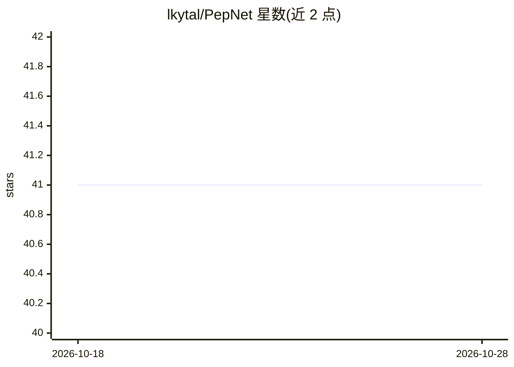

# lkytal/PepNet

⭐ 41 · Python · 推送 2026-06-10 · [GitHub](https://github.com/lkytal/PepNet) · [官网](https://denovo.predfull.com/) · 个人维护

**基于全卷积神经网络的串联质谱从头肽测序模型**

面向蛋白质组学科研用户的深度学习工具：用残差卷积网络对串联质谱（HCD，电荷 1+ 至 4+）做 de novo 肽段测序，精度 0.1 Th。使用需 clone 仓库并从 zenodo 下载预训练模型 model.h5，依赖 Python≥3.7 与 Tensorflow 2.5.0–2.14 等包，通过 denovo.py 命令读取 MGF 文件输出带打分的肽序列（限未修饰、长度≤30、固定 C 碳氨甲基化）。提供在线预测站点与训练代码，GPU 上约 59 秒测序 1 万条谱图。学术用途免费，LGPL 许可。

## 筛选速览

| 维度 | 判定 | 备注 |
|---|---|---|
| AI 角色 | `ai-native` | 本体是模型或模型工具 |
| 许可风险 | `none` | — |
| 部署形态 | `None` |  |
| 模型依赖 | — | README 未给出锁定关系 |
| 硬件要求 | — | 无带数字的原话,不猜 |
| 安装摩擦 | `low` | 无编译、无系统依赖或容器化 |
| 成熟度 | — | 结构信号不足 |

## 能力要点

- 残差卷积网络做 de novo 肽测序（0.1 Th 精度）
- 提供预训练模型与 denovo.py 推理命令
- 支持评估脚本生成性能图与训练代码 train.py
- 兼容 DIA 数据（复用 DeepNovo-DIA 伪谱方法）

## 适用场景

- 对 HCD 质谱数据做 de novo 肽段测序
- 评估测序性能（示例数据与评估图生成）
- 复现或继续训练模型

## 场景标签

`科研工具` · 领域:学习与行业

## 证据(README 行号)

> L7: The state of the art Deep CNN neural network for *de novo* sequencing of tandem mass spectra, currently works on unm
> L21: Based on the structure of the residual convolutional networks. Current precision (bin size): 0.1 Th.

## 星数曲线

2026-10-18 41 → 2026-10-28 41（+0）

---
*卡片 v1 · prompt 1.4 · 生成 2026-10-25 · 置信度 high · 依据 README sha `ec0b72f419e4` · [字段定义](../../DATASET.md)*
