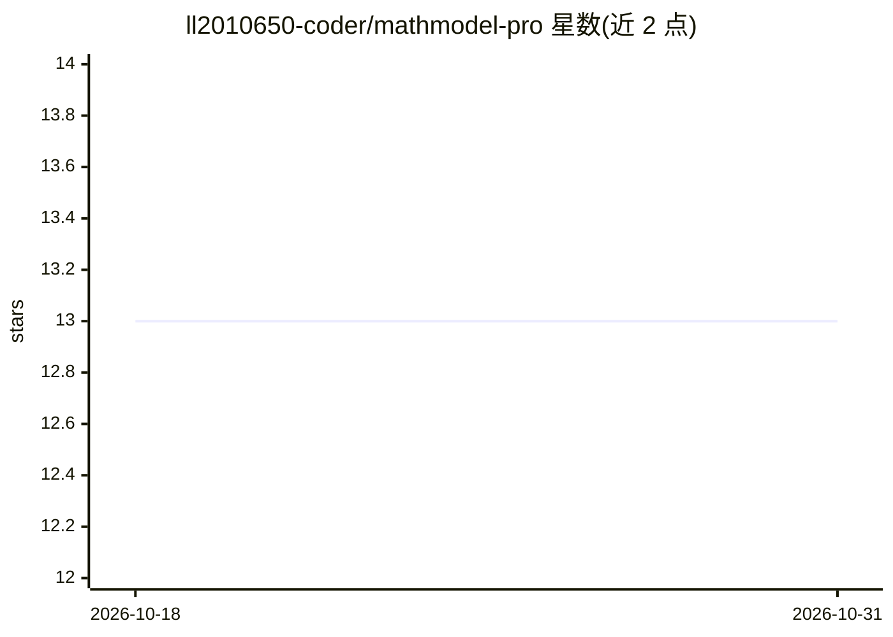

# ll2010650-coder/mathmodel-pro

⭐ 13 · Python · MIT · 推送 2026-07-27 · [GitHub](https://github.com/ll2010650-coder/mathmodel-pro) · 个人维护 · 中文 README

**数学建模竞赛全流程 AI Agent 工作流 Skill 与方法论手册**

面向数学建模竞赛（国赛 CUMCM、美赛 MCM/ICM 及邀请赛）参赛者的 AI Agent 技能包：以 SKILL.md 为主文件，把一次比赛拆解为审题、建模、编程、图表、论文、验收六个阶段，每阶段含操作手册、量化验收标准与教训清单；内置 9 份国赛获奖论文范式提炼与分题型方法论，并提供 Markdown→pandoc→MathType 的 Word 论文生成流程。使用方式为将文件复制到 AI Agent 的 skills 目录（如 .claude/skills/）后由 Agent 调用。

## 筛选速览

| 维度 | 判定 | 备注 |
|---|---|---|
| AI 角色 | `ai-knowledge` | 知识聚合/清单类 |
| 许可风险 | `permissive` | MIT |
| 部署形态 | `None` |  |
| 模型依赖 | — | README 未给出锁定关系 |
| 硬件要求 | — | 无带数字的原话,不猜 |
| 安装摩擦 | `low` | 无编译、无系统依赖或容器化 |
| 成熟度 | — | 结构信号不足 |

## 能力要点

- 六阶段操作手册，每阶段含输入、步骤、产出物与验收标准
- 优化/预测/评价/机理/网络五题型选型决策树与防错速查
- Word 论文生产线：Markdown→pandoc→三线表→MathType 公式转换
- 两级验收门禁：硬错误 FAIL 必修与警告 WARN，占位符零容忍

## 适用场景

- 数学建模竞赛中按六阶段流程完成从读题到交稿的全流程
- 让 AI Agent 按国赛规范生成合规 Word 论文与图表
- 竞赛训练中对照验收标准自查论文质量

## 场景标签

`AI 写作` `教程课程` · 领域:内容生成

## 证据(README 行号)

> L27: **数学建模Pro** 是一个为数学建模竞赛（国赛 CUMCM / 美赛 MCM/ICM / 各类邀请赛）打造的 AI Agent 全流程工作流 Skill。它把一次完整的建模比赛拆解为 **审题 → 建模 → 编程 → 图表 →
> L45: ├── SKILL.md                              # 主文件:六阶段操作手册

## 星数曲线

2026-10-18 13 → 2026-10-31 13（+0）

---
*卡片 v1 · prompt 1.4 · 生成 2026-10-31 · 置信度 high · 依据 README sha `4b1225e76bbc` · [字段定义](../../DATASET.md)*
