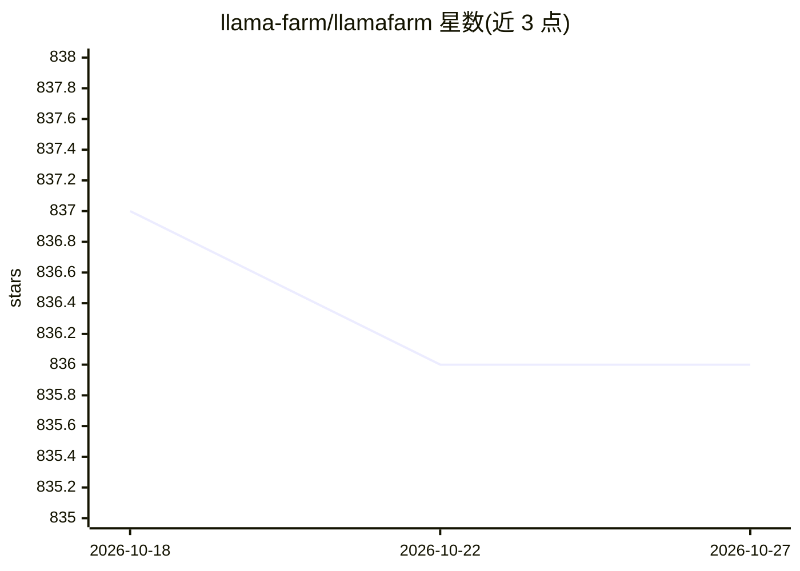

# llama-farm/llamafarm

⭐ 836 · Python · Apache-2.0 · 推送 2026-06-10 · [GitHub](https://github.com/llama-farm/llamafarm) · [官网](https://llamafarm.dev) · 组织维护

**本地优先的开源 AI 平台：自建 RAG、训练分类器、异常检测与文档处理**

在自有硬件上运行的 AI 平台，由 Server（FastAPI REST API 与 Designer Web UI）、RAG Worker（Celery 异步文档处理）、Universal Runtime（模型推理/嵌入/OCR/异常检测）三个服务组成。面向需本地化部署的开发者，提供 RAG 管道、SetFit 少样本文本分类（8-16 示例）、基于 PyOD 的 12+ 种批式/流式异常检测、OCR 与文档抽取、NER、MCP 工具调用。运行时可在 Universal Runtime、Ollama、vLLM 及 OpenAI 兼容端点间切换；配置集中于 llamafarm.yaml。提供 Mac/Windows/Linux 桌面安装包与 CLI，依赖 Python 3.10+ 与 Go 1.24+。

## 筛选速览

| 维度 | 判定 | 备注 |
|---|---|---|
| AI 角色 | `ai-ecosystem` | LLM/agent 周边工具 |
| 许可风险 | `permissive` | Apache-2.0 |
| 部署形态 | `None` |  |
| 模型依赖 | local-ok | 支持本地模型 |
| 硬件要求 | — | 无带数字的原话,不猜 |
| 安装摩擦 | `low` | 无编译、无系统依赖或容器化 |
| 成熟度 | — | 结构信号不足 |

## 能力要点

- 三种运行时后端可选：Universal Runtime / Ollama / OpenAI 兼容端点（vLLM 等）
- RAG 管道：数据集创建、PDF/DOCX/Markdown/TXT 上传自动处理、语义查询
- 12+ 种异常检测算法（PyOD），支持批式与流式模式
- SetFit 少样本文本分类与 MCP 工具调用；暴露 OpenAI 兼容 REST API 与自身 API 作为 MCP 工具

## 适用场景

- 本地构建 PDF/文档知识库并进行 RAG 问答
- 在 IoT 传感数据上做流式异常检测（含欺诈检测示例）
- 用少量样本训练专属文本分类器
- 通过 Designer Web UI 可视化管理数据集、提示词与 RAG 配置

## 场景标签

`RAG` `OCR` · 领域:知识与检索

## 证据(README 行号)

> L11: **LlamaFarm** is an open-source AI platform that runs entirely on your hardware. Build RAG applications, train cust
> L92: LlamaFarm consists of three main services:
> L104: ### Universal Runtime (Recommended)

## 星数曲线

2026-10-18 837 → 2026-10-27 836（-1）

---
*卡片 v1 · prompt 1.4 · 生成 2026-10-21 · 置信度 high · 依据 README sha `d49dec644115` · [字段定义](../../DATASET.md)*
