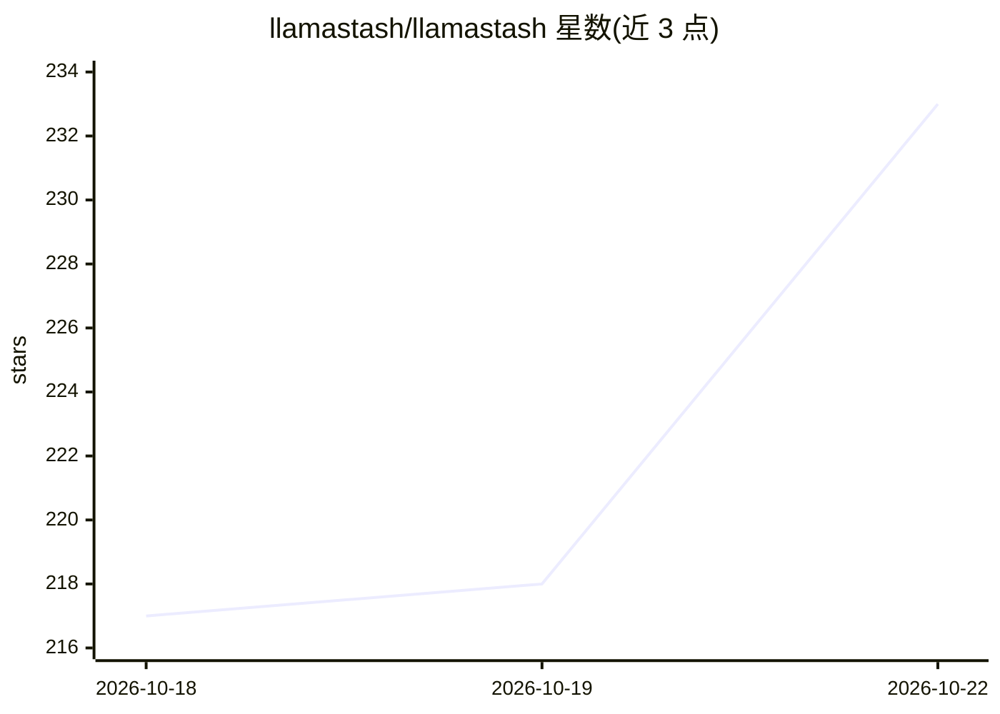

# llamastash/llamastash

⭐ 242 · Rust · MIT · 推送 2026-10-22 · [GitHub](https://github.com/llamastash/llamastash) · [官网](https://llamastash.dev) · 个人维护

**终端本地 LLM 编排器：一个二进制统一运行多引擎与模型**

Rust 编写的单二进制工具，集 TUI、CLI、守护进程与 OpenAI 兼容代理于一体，用于运行本地 LLM。默认后端为 llama.cpp（零开销直连），另支持 vLLM、SGLang 及通过通用后端接入任意 OpenAI 兼容服务器（含 Lemonade NPU、FastFlowLM、whisper.cpp 等）。init 向导检测硬件、安装 llama-server、下载启动 GGUF；自动扫描 HuggingFace/Ollama/LM Studio 缓存；代理默认绑定回环端口 11435，提供 OpenAI 与 Anthropic Messages API，并可选 Ollama drop-in 兼容模式。面向开发者与 agent 脚本场景。

## 筛选速览

| 维度 | 判定 | 备注 |
|---|---|---|
| AI 角色 | `ai-ecosystem` | LLM/agent 周边工具 |
| 许可风险 | `permissive` | MIT |
| 部署形态 | `self-host` | docker 或自建部署 |
| 模型依赖 | local-ok | 支持本地模型 |
| 硬件要求 | — | 无带数字的原话,不猜 |
| 安装摩擦 | `low` | 无编译、无系统依赖或容器化 |
| 成熟度 | — | 结构信号不足 |

## 能力要点

- 单 Rust 二进制同时充当 TUI、CLI、守护进程与 OpenAI 兼容代理
- 默认 llama.cpp 零开销后端，vLLM/SGLang 与通用后端可扩展
- 自动扫描 HuggingFace/Ollama/LM Studio 模型缓存并提供 VRAM 适配推荐
- 面向 agent 的稳定 CLI 契约（--json、文档化退出码）

## 适用场景

- 在终端统一管理并启动本地多个 LLM 引擎与模型
- 让 Claude Code、OpenCode、Aider 等工具通过本地代理使用任意模型
- 为 AI agent 提供可脚本化的本地模型管理 CLI

## 场景标签

`推理引擎` `模型网关` · 领域:Agent 开发

## 证据(README 行号)

> L18: **Zero-overhead, terminal-native local-LLM orchestrator. Run any engine, any model via the same proxy.**
> L20: A fast TUI **and** CLI with init wizard for running local LLMs. One Rust binary that's a TUI, a CLI, a daemon, and 
> L30: Heavy abstractions (Ollama, LM Studio) hide llama.cpp; raw `llama-server` use is tedious. LlamaStash is a fast, tra

## 星数曲线

2026-10-18 217 → 2026-10-22 233（+16）

---
*卡片 v1 · prompt 1.4 · 生成 2026-10-22 · 置信度 mid · 依据 README sha `51e5307410d1` · [字段定义](../../DATASET.md)*
