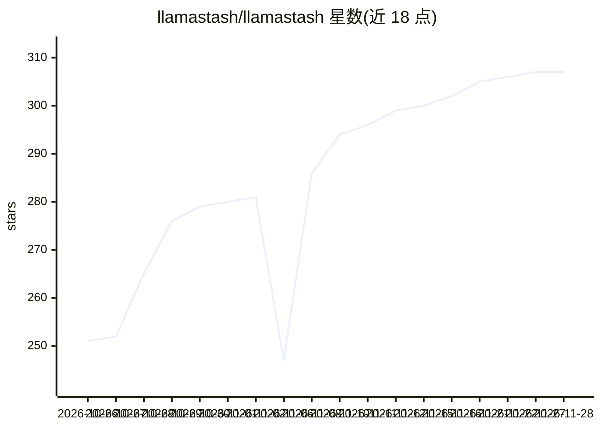

# llamastash/llamastash

⭐ 307 · Rust · MIT · 推送 2026-11-27 · [GitHub](https://github.com/llamastash/llamastash) · [官网](https://llamastash.dev) · 个人维护

**本地 LLM 编排器：一个代理统一管理多引擎与模型**

用 Rust 编写的单二进制本地 LLM 编排工具，提供 TUI、CLI、守护进程与 OpenAI 兼容代理四种形态。默认驱动 llama.cpp 运行 GGUF 模型，通过通用 backend 声明接入任意 OpenAI 兼容服务器（Lemonade、FastFlowLM、whisper.cpp 等），vLLM 与 SGLang 以实验性支持运行 safetensors 仓库。init 向导检测硬件、安装 llama-server、下载入门模型并写配置；可扫描 HuggingFace、Ollama、LM Studio 缓存发现已有模型。提供 bash/zsh/fish 等 shell 补全与 Agent Skills 清单供 agent 调用。

## 筛选速览

| 维度 | 判定 | 备注 |
|---|---|---|
| AI 角色 | `ai-ecosystem` | LLM/agent 周边工具 |
| 许可风险 | `permissive` | MIT |
| 部署形态 | `self-host` | docker 或自建部署 |
| 模型依赖 | local-ok | 支持本地模型 |
| 硬件要求 | — | 无带数字的原话,不猜 |
| 安装摩擦 | `low` | 无编译、无系统依赖或容器化 |
| 成熟度 | — | 结构信号不足 |

## 能力要点

- 单二进制提供 TUI、CLI、守护进程与 OpenAI 兼容代理
- llama.cpp 为默认引擎，通用 backend 可声明任意 OpenAI 兼容服务器
- init 向导检测硬件、安装 llama-server 并下载入门 GGUF
- 自动扫描 HuggingFace、Ollama、LM Studio 缓存发现已有模型

## 适用场景

- 在一台终端里用统一入口启动和管理多个本地推理引擎
- 为本地模型暴露一个 OpenAI 兼容代理 URL 供客户端调用
- 让 AI agent 通过 CLI 和 Agent Skills 管理本地模型

## 场景标签

`推理引擎` `模型网关` · 领域:Agent 开发

## 证据(README 行号)

> L20: A fast TUI **and** CLI with init wizard for running local LLMs. One Rust binary that's a TUI, a CLI, a daemon, and 
> L93: |llama.cpp|any GGUF|stable, default|built in; `llamastash init` installs `llama-server`|
> L145: The CLI ships with an Agent Skills manifest so supported agents can load repo-specific instructions for using `lla

## 星数曲线

2026-10-26 251 → 2026-11-28 307（+56）

---
*卡片 v1 · prompt 1.4 · 生成 2026-11-25 · 置信度 mid · 依据 README sha `34c36ef3f2bc` · [字段定义](../../DATASET.md)*
