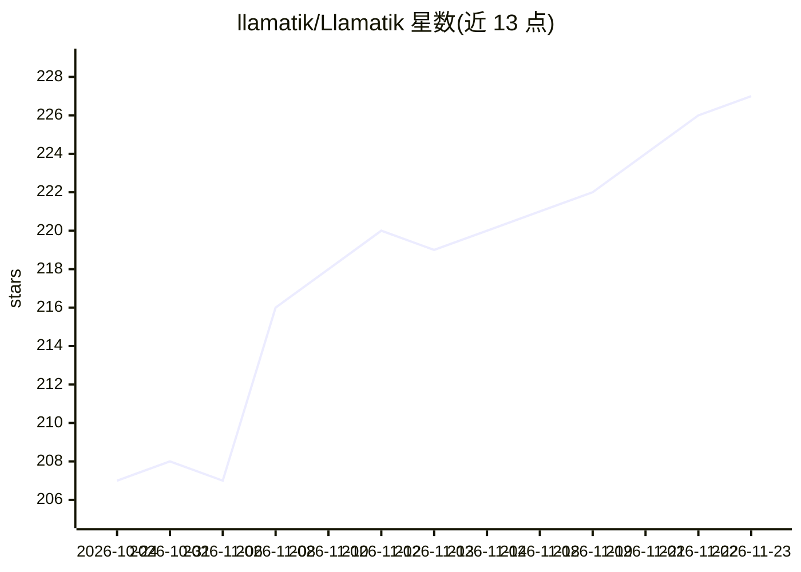

# llamatik/Llamatik

⭐ 227 · Kotlin · NOASSERTION · 推送 2026-11-20 · [GitHub](https://github.com/llamatik/Llamatik) · [官网](https://www.llamatik.com) · 组织维护

**Kotlin 跨平台端侧 AI SDK：LLM/语音/图像生成与 Agent 框架**

面向 Kotlin Multiplatform 开发者的端侧 AI SDK，覆盖 Android、iOS、Desktop(JVM) 与 WASM。核心模块 `core` 提供 llama.cpp/whisper.cpp/stable-diffusion.cpp 的 Kotlin 绑定，支持文本生成（含 schema 约束 JSON、流式、并发会话）、离线语音转写、文生图/图生图/文生视频与 ControlNet；`sdk` 模块提供 RAG 向量存储、模型下载编排与 Agent DSL（记忆、工具、工作流）；`sdk-agent` 提供 AgentRuntime、权限管理与审计日志。默认全离线，可选自托管服务器，README 注明服务器连接当前为未加密明文 HTTP。通过 Maven Central 以 Gradle 依赖安装，iOS 16.6+/Android API 26+/JVM 21+。

## 筛选速览

| 维度 | 判定 | 备注 |
|---|---|---|
| AI 角色 | `ai-ecosystem` | LLM/agent 周边工具 |
| 许可风险 | `none` | NOASSERTION |
| 部署形态 | `None` |  |
| 模型依赖 | local-ok | 支持本地模型 |
| 硬件要求 | — | 无带数字的原话,不猜 |
| 安装摩擦 | `high` | 编译与系统依赖俱全 |
| 成熟度 | — | 结构信号不足 |

## 能力要点

- llama.cpp/whisper.cpp/stable-diffusion.cpp 的统一 Kotlin API 绑定
- Agent DSL：记忆、内置/自定义工具、流式输出与工作流
- RAG 向量存储（余弦相似度、MMR）与模型下载编排
- 默认全离线端侧推理，支持多平台（Android/iOS/Desktop/WASM）

## 适用场景

- 在 Android/iOS 应用中内置离线聊天助手或语音转写
- 构建本地 RAG 问答应用
- 开发带工具调用与权限控制的端侧 AI Agent

## 场景标签

`Agent 框架` `RAG` `语音识别` `图像生成` · 领域:Agent 开发

## 证据(README 行号)

> L83: **Llamatik** is a Kotlin Multiplatform AI SDK that covers the full stack — from low-level on-device inference to hi
> L87: - 🔬 **Inference Library** (`com.llamatik:core`) — direct Kotlin bindings to the best open-source native inference e
> L88:  - 🧠 **LLMs** via `llama.cpp`

## 星数曲线

2026-10-24 207 → 2026-11-23 227（+20）

---
*卡片 v1 · prompt 1.4 · 生成 2026-11-17 · 置信度 high · 依据 README sha `f757e0a1bc48` · [字段定义](../../DATASET.md)*
