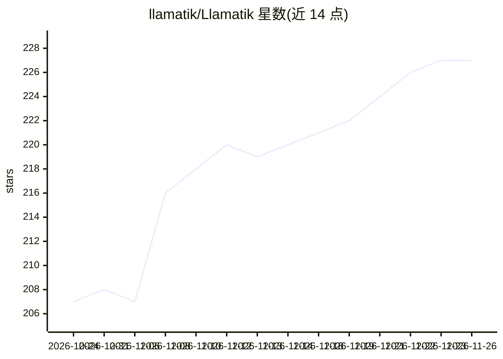

# llamatik/Llamatik

⭐ 227 · Kotlin · NOASSERTION · 推送 2026-11-25 · [GitHub](https://github.com/llamatik/Llamatik) · [官网](https://www.llamatik.com) · 组织维护

**Kotlin 跨平台本地 AI SDK：端侧 LLM/语音/图像推理**

面向 Kotlin Multiplatform 开发者的本地推理 SDK，分三个模块：core 提供对 llama.cpp（文本生成、嵌入、VLM）、whisper.cpp（离线转写）、stable-diffusion.cpp（文生图/视频）的 Kotlin 绑定；sdk 提供聊天、模型管理、RAG 向量存储与 Agent Framework DSL；sdk-agent 提供带权限管理、审计日志与工作流引擎的 AgentRuntime。全流程默认端侧离线运行，也支持可选的自托管服务器做混合部署。通过 Maven Central 发布，iOS 16.6+/Android API 26+/JVM 21+/WASM 可用。

## 筛选速览

| 维度 | 判定 | 备注 |
|---|---|---|
| AI 角色 | `ai-ecosystem` | LLM/agent 周边工具 |
| 许可风险 | `none` | NOASSERTION |
| 部署形态 | `None` |  |
| 模型依赖 | local-ok | 支持本地模型 |
| 硬件要求 | — | 无带数字的原话,不猜 |
| 安装摩擦 | `high` | 编译与系统依赖俱全 |
| 成熟度 | — | 结构信号不足 |

## 能力要点

- 统一 Kotlin API 覆盖 LLM 推理、语音转写、图像/视频生成
- Agent Framework DSL：内存、工具注册、流式输出、工作流
- AgentRuntime 含权限→确认→执行→审计管线与 9 个内置平台工具
- 默认全离线端侧运行，模型与数据不出设备

## 适用场景

- 在 Android/iOS 应用里集成离线聊天机器人
- 构建本地 RAG 系统与隐私优先的 AI 应用
- 离线语音转写与端侧文生图
- 游戏内的本地对话与 AI 行为

## 场景标签

`推理引擎` `Agent 框架` `RAG` `语音识别` · 领域:Agent 开发

## 证据(README 行号)

> L5:  Run AI locally on Android, iOS, Desktop and WASM — using a single Kotlin API.
> L83: **Llamatik** is a Kotlin Multiplatform AI SDK that covers the full stack — from low-level on-device inference to hi
> L87: - 🔬 **Inference Library** (`com.llamatik:core`) — direct Kotlin bindings to the best open-source native inference e

## 星数曲线

2026-10-24 207 → 2026-11-26 227（+20）

---
*卡片 v1 · prompt 1.4 · 生成 2026-11-25 · 置信度 mid · 依据 README sha `0a656c1ad97c` · [字段定义](../../DATASET.md)*
