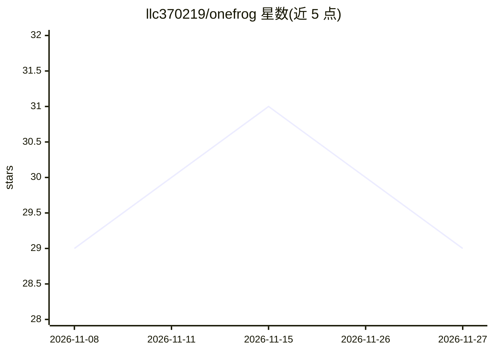

# llc370219/onefrog

⭐ 29 · Go · AGPL-3.0 · 推送 2026-11-09 · [GitHub](https://github.com/llc370219/onefrog) · 个人维护 · 中文 README

**自托管 AI 运维面板：对话管理 SSH 服务器、Bot 与审批流程**

通过 Web 面板与 AI 助理对话管理服务器的自托管运维工具：采用 Frog Bot 架构，每个 Bot 具备独立对话、后台任务、记忆与工作区；支持 SSH 接入与指纹校验、远程命令、探针监控、systemd/Docker/端口检测，提供命令审批、审计与密钥加密保险箱，可创建带交互界面的自定义模块。安装走一键脚本拉取预构建 Docker 镜像，支持 x86_64/arm64 Linux。限制：默认公网 HTTP 入口需自行配置 HTTPS 反向代理；聊天内容会发送给配置的模型服务。

## 筛选速览

| 维度 | 判定 | 备注 |
|---|---|---|
| AI 角色 | `ai-ecosystem` | LLM/agent 周边工具 |
| 许可风险 | `viral` | AGPL-3.0 |
| 部署形态 | `None` |  |
| 模型依赖 | — | README 未给出锁定关系 |
| 硬件要求 | — | 无带数字的原话,不猜 |
| 安装摩擦 | `low` | 无编译、无系统依赖或容器化 |
| 成熟度 | `idea` | |

## 能力要点

- Frog Bot 架构：每个 Bot 独立对话、后台任务、记忆与工作区
- SSH 指纹校验、命令审批、审计与密钥加密保险箱
- 一键脚本安装预构建 Docker 镜像，无需 Go 或 Node.js
- 支持 systemd 服务、Docker 容器与监听端口检测

## 适用场景

- 通过对话让 AI 助理在服务器上执行运维操作并走审批流程
- 集中管理多台服务器的 SSH、监控与服务状态
- 以自定义模块扩展面板功能并记录资产

## 场景标签

`AI 助手` · 领域:对话与助手

## 证据(README 行号)

> L7: 自托管的 AI 运维面板：通过对话管理服务器、Bot、密钥保险箱和自定义模块，执行过程、交互选项与审批结果都留在面板中。
> L13: - **AI 助理**：采用 Frog Bot 架构，每个 Bot 都是一个助理，有自己的对话、后台任务、记忆和工作区。服务器操作走 OneFrog 的审批、审计和指纹校验，定时计划、密钥和登录都用 OneFrog 自己的。

## 星数曲线

2026-11-08 29 → 2026-11-27 29（+0）

---
*卡片 v1 · prompt 1.4 · 生成 2026-11-18 · 置信度 high · 依据 README sha `f8f0d0c75278` · [字段定义](../../DATASET.md)*
