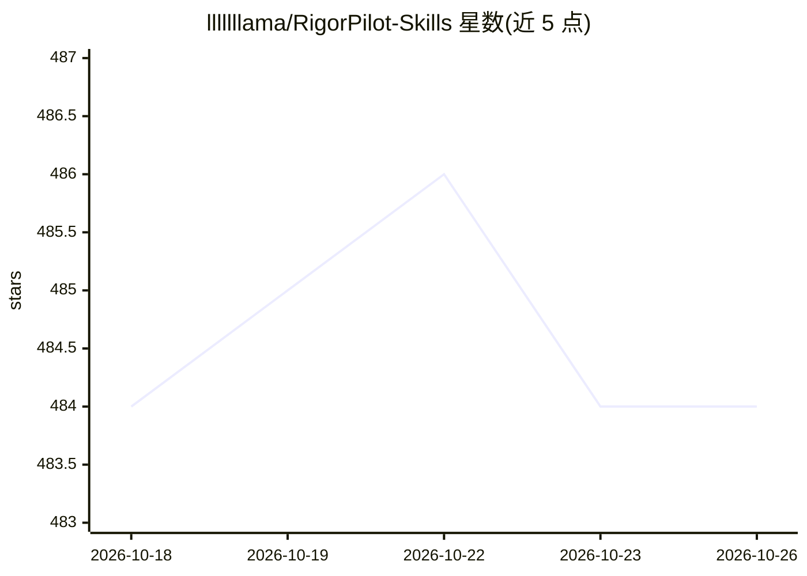

# lllllllama/RigorPilot-Skills

⭐ 484 · Python · MIT · 推送 2026-09-23 · [GitHub](https://github.com/lllllllama/RigorPilot-Skills) · 个人维护 · 中文 README

**供 agent 使用的科研仓库 README 复现技能包：有界执行+留证**

面向 Skills 兼容 agent 的技能集合：从目标研究仓库的 README 中解析文档化命令，经计划指纹审核后做有界本地执行，在每个章节插入证据卡片，且删除插入块后原 README 字节级还原。产出 repro_outputs/ 证据包（SUMMARY/COMMANDS/LOG/manifest/哈希等），区分可信复现与需显式授权的候选探索。通过 npx skills 安装，需 Node ≥22.20.0。可选模型运行器支持 Anthropic Messages，但尚无成功的在线模型验收记录；执行是本地执行而非 OS 沙箱。

## 筛选速览

| 维度 | 判定 | 备注 |
|---|---|---|
| AI 角色 | `ai-ecosystem` | LLM/agent 周边工具 |
| 许可风险 | `permissive` | MIT |
| 部署形态 | `library` | 以包/库形式分发 |
| 模型依赖 | — | README 未给出锁定关系 |
| 硬件要求 | — | 无带数字的原话,不猜 |
| 安装摩擦 | `low` | 无编译、无系统依赖或容器化 |
| 成熟度 | — | 结构信号不足 |

## 能力要点

- README 命令解析→计划指纹绑定→有界执行→验证的证据链
- 原 README 字节级保留，按章节插入证据卡
- 完整证据包：命令/日志/SHA-256 清单/运行时状态与轨迹
- 9 个技能覆盖复现、分析、训练、调试与受控探索

## 适用场景

- 让 agent 按原仓库 README 复现最小评估并留证据
- 审阅他人研究的可复现性并获取逐节判定
- 在授权分支上做有界的候选实验探索

## 场景标签

`科研工具` · 领域:学习与行业

## 证据(README 行号)

> L81: npx skills add lllllllama/RigorPilot-Skills --skill ai-research-reproduction
> L104: |Plan|Lists README-backed `cmd-XX` candidates, selects the smallest trusted target, and returns a selection finger
> L127: The optional model loop currently supports Anthropic Messages and reviewed command

## 星数曲线

2026-10-18 484 → 2026-10-26 484（+0）

---
*卡片 v1 · prompt 1.4 · 生成 2026-10-21 · 置信度 mid · 依据 README sha `40f5cd91d7af` · [字段定义](../../DATASET.md)*
