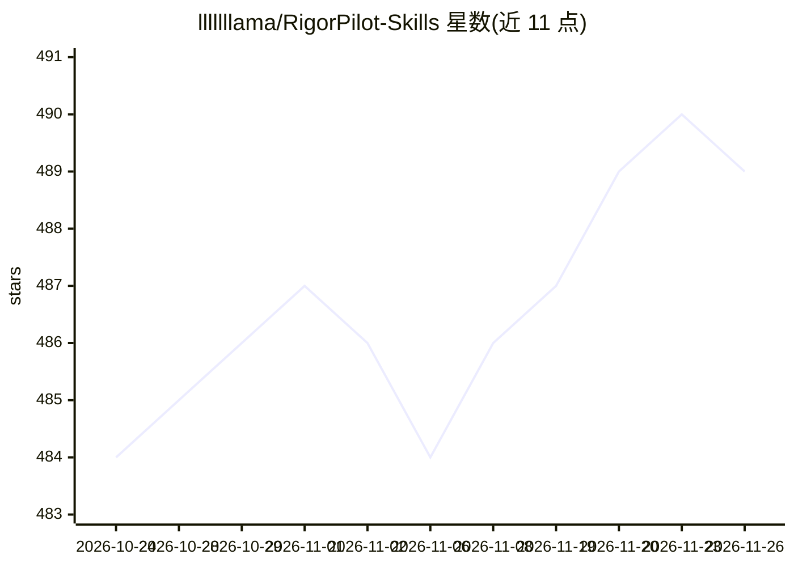

# lllllllama/RigorPilot-Skills

⭐ 489 · Python · MIT · 推送 2026-11-20 · [GitHub](https://github.com/lllllllama/RigorPilot-Skills) · [官网](https://lllllllama.github.io/research-reproduction/) · 个人维护 · 中文 README

**让 agent 按研究仓库 README 复现实验并留存证据的技能集**

以 Agent Skills 标准发布的一组技能，核心技能 ai-research-reproduction 使 agent 从研究仓库 README 中提取文档化命令，经 plan→run→verify 三阶段在执行预算内运行目标评估，输出 repro_outputs/ 证据包与字节级保留的标注版 README。区分可信复现与需显式授权的候选探索，独立核验执行结果而非采信模型声明。本机执行而非 OS 沙箱，可选模型循环仅支持 Anthropic Messages 且尚无成功实测记录。

## 筛选速览

| 维度 | 判定 | 备注 |
|---|---|---|
| AI 角色 | `ai-ecosystem` | LLM/agent 周边工具 |
| 许可风险 | `permissive` | MIT |
| 部署形态 | `library` | 以包/库形式分发 |
| 模型依赖 | — | README 未给出锁定关系 |
| 硬件要求 | — | 无带数字的原话,不猜 |
| 安装摩擦 | `low` | 无编译、无系统依赖或容器化 |
| 成熟度 | `idea` | |

## 能力要点

- plan/run/verify 三阶段，指纹绑定执行到已审阅的 README 命令集
- 证据包含 SUMMARY/LOG/status.json、SHA-256 清单，并可生成字节可还原的标注版 README
- 9 个技能覆盖复现、只读分析、环境准备、保守训练与授权探索
- 四案例确定性回放：251 秒、峰值 98.67 MiB、0 次模型 API 调用

## 适用场景

- 让 agent 按论文仓库 README 跑最小评估并留存可审计证据
- 复现实验时保留原 README 与失败尝试的完整记录
- 对候选改动做受控探索而不污染可信基线结果

## 场景标签

`科研工具` · 领域:学习与行业

## 证据(README 行号)

> L3: Run research repositories from their README, with bounded execution and auditable evidence.
> L94: Open the target repository in a Skills-capable agent, then ask:
> L99: Your existing agent loads the skill. The standalone model runner is optional.

## 星数曲线

2026-10-24 484 → 2026-11-26 489（+5）

---
*卡片 v1 · prompt 1.4 · 生成 2026-11-25 · 置信度 low · 依据 README sha `3c81a3f41ad0` · [字段定义](../../DATASET.md)*
