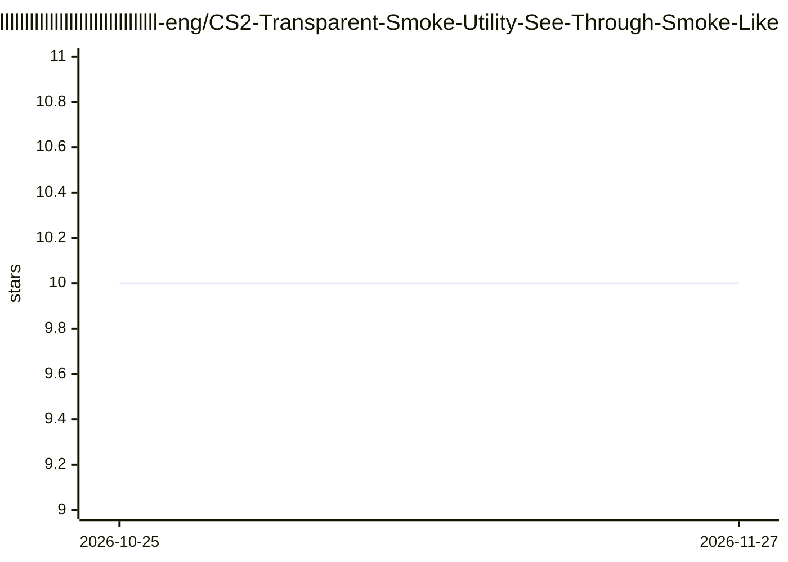

# llllllllllllllllllllllllllllllll-eng/CS2-Transparent-Smoke-Utility-See-Through-Smoke-Like-Glass

⭐ 10 · MIT · 推送 2026-05-24 · [GitHub](https://github.com/llllllllllllllllllllllllllllllll-eng/CS2-Transparent-Smoke-Utility-See-Through-Smoke-Like-Glass) · 个人维护

**修改 CS2 烟雾弹贴图的 Windows 工具：让烟雾变透明**

面向 Counter-Strike 2 玩家的 Windows 桌面工具，通过替换本地游戏纹理文件改变烟雾弹的视觉表现，使烟雾呈半透明。要求 Windows 10/11、Steam 正版 CS2、独立显卡与管理员权限。以 .exe 安装包分发，图形界面勾选启用，提供 Restore Original Files 一键还原。README 明确提示修改游戏文件可能触发 VAC 反作弊检测，风险自担，建议先在离线练习图测试。README 未涉及 AI 或机器学习相关功能。

## 筛选速览

| 维度 | 判定 | 备注 |
|---|---|---|
| AI 角色 | `ai-enhanced` | 去掉 AI 部分产品仍成立 |
| 许可风险 | `permissive` | MIT |
| 部署形态 | `desktop` | 安装包/桌面程序 |
| 模型依赖 | — | README 未给出锁定关系 |
| 硬件要求 | — | 无带数字的原话,不猜 |
| 安装摩擦 | `low` | 无编译、无系统依赖或容器化 |
| 成熟度 | — | 结构信号不足 |

## 能力要点

- 替换本地纹理文件实现烟雾透明视觉效果
- 提供一键还原原始游戏文件功能
- 以 .exe 安装包分发，无需编译
- README 列明系统要求与 VAC 风险提示

## 适用场景

- 在 CS2 离线练习地图中查看透明烟雾效果
- 需要还原时通过工具恢复默认纹理文件

## 场景标签

 · 领域:游戏/桌面工具

## 证据(README 行号)

> L11: The CS2 Transparent Smoke Utility changes how smoke grenades look in Counter-Strike 2. Standard smoke grenades crea
> L17: - Operating System: Windows 10 or Windows 11.
> L56: This utility modifies local game files to change visual output. Counter-Strike 2 uses VAC (Valve Anti-Cheat). Modif

## 星数曲线

2026-10-25 10 → 2026-11-27 10（+0）

---
*卡片 v1 · prompt 1.4 · 生成 2026-11-19 · 置信度 mid · 依据 README sha `86dc37c3cdd4` · [字段定义](../../DATASET.md)*
