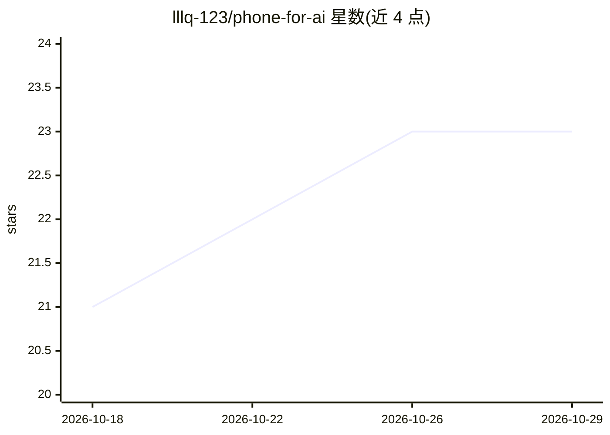

# lllq-123/phone-for-ai

⭐ 23 · Java · MIT · 推送 2026-10-06 · [GitHub](https://github.com/lllq-123/phone-for-ai) · 个人维护 · 中文 README

**让 AI agent 远程操控一台闲置安卓手机的自托管工具包**

由 Android 伴侣 APK、自托管服务端、MCP 接入与网页远程控制台组成：手机主动连接用户自己的 HTTPS 服务器，agent 通过 MCP 执行截图、读控件树、点按滑动、中文输入、打开 App；开启 Root 扩展后可运行 shell、读写文件、传文件，网页端支持实时投屏与触控（WebCodecs）。不自带模型，需配合支持 MCP 与图片的 agent 使用；要求 Android 14+ 且手动开启无障碍服务，首版仅在一加 8T / Android 14 实测。

## 筛选速览

| 维度 | 判定 | 备注 |
|---|---|---|
| AI 角色 | `ai-ecosystem` | LLM/agent 周边工具 |
| 许可风险 | `permissive` | MIT |
| 部署形态 | `library` | 以包/库形式分发 |
| 模型依赖 | — | README 未给出锁定关系 |
| 硬件要求 | — | 无带数字的原话,不猜 |
| 安装摩擦 | `medium` | 含编译或系统依赖之一 |
| 成熟度 | `idea` | |

## 能力要点

- 手机反向连接自托管服务器，无需公网入站端口、不依赖 USB/ADB
- MCP 接入：截图、控件树读取、点按/滑动/中文输入等通用工具
- Root 扩展：shell 执行、文件读写、scrcpy 实时投屏到网页控制台
- 网页控制台可人工直接触控操作同一台手机

## 适用场景

- 让我的 agent 操作已登录的淘宝/美团/小红书等 App 完成任务
- 把闲置安卓手机变成 agent 的执行终端，远程截图与操作
- 通过网页控制台人工接管或观察 agent 的操作过程

## 场景标签

`GUI 自动化` · 领域:效率与自动化

## 证据(README 行号)

> L11: 这里提供从日用版本整理出的**独立 Android 伴侣、服务端、MCP、网页远程控制台和中文教程**。它不自带模型；你继续用自己的 agent，也可以打开网页亲手操作。
> L30:     A[你的 AI agent] -->|stdio MCP| M[Phone for AI MCP]
> L44: 4. 把 `phone-for-ai mcp` 接到支持 MCP 和图片的 agent。

## 星数曲线

2026-10-18 21 → 2026-10-29 23（+2）

---
*卡片 v1 · prompt 1.4 · 生成 2026-10-27 · 置信度 mid · 依据 README sha `d5e2517c2416` · [字段定义](../../DATASET.md)*
