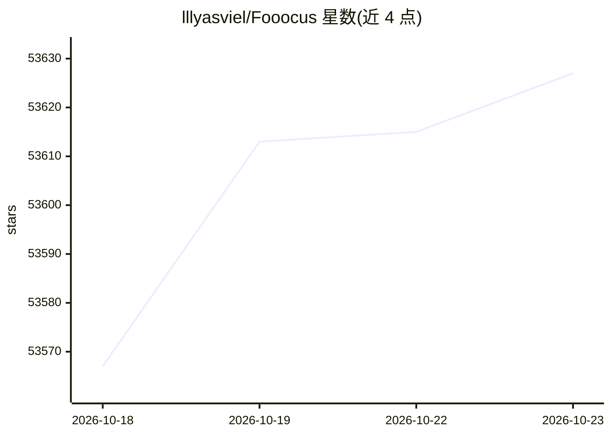

# lllyasviel/Fooocus

⭐ 53,627 · Python · GPL-3.0 · 推送 2025-12-01 · [GitHub](https://github.com/lllyasviel/Fooocus) · 个人维护

**面向普通用户的离线文生图软件：专注提示词即可出图**

基于 Gradio 与 Stable Diffusion XL 架构的图像生成软件，离线、开源、免费。安装即用：从下载到生成首图点击少于 3 次，最低 4GB Nvidia 显存即可运行。内置离线 GPT-2 提示词处理引擎与采样优化，支持文生图、放大、变体、内绘/外绘、图像提示与 FaceSwap；提供 Windows 安装包、Colab、Anaconda/venv/系统 Python 及 AMD GPU（beta）多种运行途径。项目目前处于仅修复 bug 的 LTS 状态。

## 筛选速览

| 维度 | 判定 | 备注 |
|---|---|---|
| AI 角色 | `ai-enhanced` | 去掉 AI 部分产品仍成立 |
| 许可风险 | `viral` | GPL-3.0 |
| 部署形态 | `desktop` | 安装包/桌面程序 |
| 模型依赖 | — | README 未给出锁定关系 |
| 硬件要求 | `gpu-8g` | |
| 安装摩擦 | `medium` | 含编译或系统依赖之一 |
| 成熟度 | — | 结构信号不足 |

## 动量与使用信号

- 维护:`declining` — 距上次 push 320.5 天,年发版 0,59 位贡献者
- 涨星:近 1 天 **+44**(自 20261016 起算)
- 安装:pypi 包 `requirements_versions.txt` 月下载无数据
- 平台:WINDOWS / WEB · 协议:—

## 能力要点

- 基于 SDXL 架构，内置离线 GPT-2 提示词处理引擎
- 最低 4GB Nvidia VRAM + 8GB RAM 即可运行
- 支持内绘/外绘、放大/变体、图像提示、FaceSwap
- 提供 Windows 一键包、Colab 与多种 Linux 安装途径

## 适用场景

- 低配置本地电脑上离线生成图像
- 不需要参数调优、只写提示词就出图
- 在 Colab 免费额度上运行文生图

## 场景标签

`图像生成` · 领域:内容生成

## 证据(README 行号)

> L5: Fooocus is an image generating software (based on Gradio ).
> L7: Fooocus presents a rethinking of image generator designs. The software is offline, open source, and free, while at t
> L13: The Fooocus project, built entirely on the **Stable Diffusion XL** architecture, is now in a state of limited long-

## 星数曲线

2026-10-18 53,567 → 2026-10-23 53,627（+60）

---
*卡片 v1 · prompt 1.4 · 生成 2026-10-18 · 置信度 mid · 依据 README sha `131802c0a303` · [字段定义](../../DATASET.md)*
