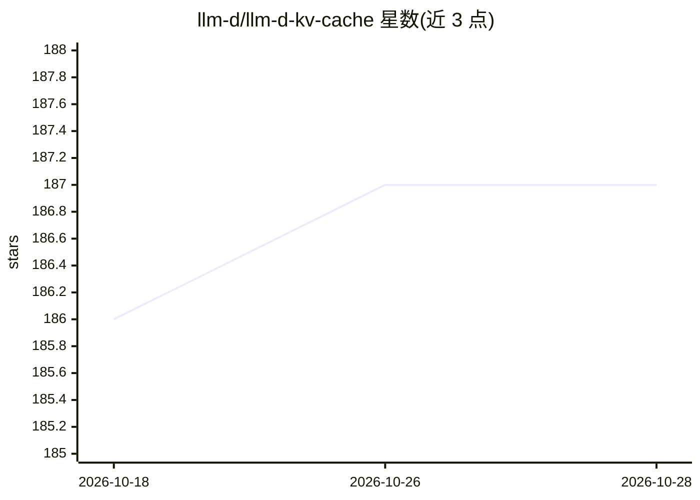

# llm-d/llm-d-kv-cache

⭐ 187 · Go · Apache-2.0 · 推送 2026-10-21 · [GitHub](https://github.com/llm-d/llm-d-kv-cache) · [官网](https://www.llm-d.ai) · 组织维护

**vLLM 平台的分布式 KV 缓存调度与卸载库**

llm-d 项目下的可插拔库集合，面向基于 vLLM 的推理服务平台提供 KV-Cache 管理能力：核心组件 KV-Cache Indexer 通过消费 vLLM 流出的 KVEvents，维护跨 vLLM Pod 集群的 KV 块位置（节点与 GPU/CPU 层级）近实时全局视图，供调度器做 KV 缓存感知路由；另含 PVC Evictor 与 llmd-fs-backend（在 GPU 与共享存储间移动 KV 块，已上游进 vLLM）。注意：索引器相关库已迁至 llm-d-router 仓库，本仓库不再承载调度逻辑。

## 筛选速览

| 维度 | 判定 | 备注 |
|---|---|---|
| AI 角色 | `ai-ecosystem` | LLM/agent 周边工具 |
| 许可风险 | `permissive` | Apache-2.0 |
| 部署形态 | `library` | 以包/库形式分发 |
| 模型依赖 | local-ok | 支持本地模型 |
| 硬件要求 | — | 无带数字的原话,不猜 |
| 安装摩擦 | `low` | 无编译、无系统依赖或容器化 |
| 成熟度 | — | 结构信号不足 |

## 能力要点

- KV-Cache Indexer 维护跨 Pod 的 KV 块位置近实时索引
- 读取路径按 prompt 计算 KV 块键并返回各 Pod 缓存命中分数
- llmd-fs-backend 在 GPU 与本地盘/共享文件系统/对象存储间移动 KV 块
- PVC Evictor 自动管理卸载连接器在 PVC 上的磁盘空间

## 适用场景

- 为 vLLM 推理集群实现 KV 缓存感知的请求路由
- 跨节点跟踪 KV 块所在节点与层级（GPU/CPU/存储）
- 将 KV 缓存卸载到共享存储以提升资源利用率

## 场景标签

`推理引擎` · 领域:训练与推理

## 证据(README 行号)

> L23: This repository contains the `llm-d-kv-cache`, a pluggable service designed to enable **KV-Cache Aware Routing** an
> L31: The major component of this project is the **KV-Cache Indexer** is a high-performance library that keeps a global, 

## 星数曲线

2026-10-18 186 → 2026-10-28 187（+1）

---
*卡片 v1 · prompt 1.4 · 生成 2026-10-22 · 置信度 high · 依据 README sha `fbbd2a83d6a9` · [字段定义](../../DATASET.md)*
