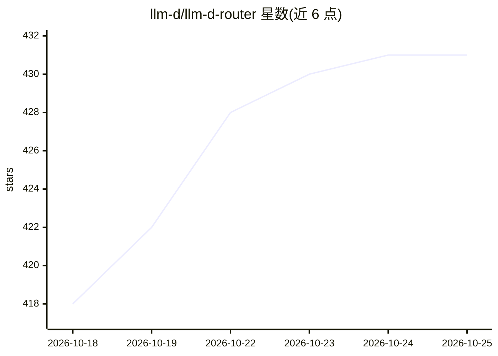

# llm-d/llm-d-router

⭐ 431 · Go · Apache-2.0 · 推送 2026-10-24 · [GitHub](https://github.com/llm-d/llm-d-router) · [官网](https://llm-d.ai/docs/architecture/core/router) · 组织维护

**Kubernetes 上的 LLM 推理流量智能路由网关**

面向 Kubernetes 环境的推理请求入口：由 Endpoint Picker（EPP）路由引擎与 Envoy 等代理组成，通过 ext-proc 协议注入实时信号，依据 KV-cache 局部性、当前负载与优先级做请求放置决策。提供 InferenceObjective 与 InferenceModelRewrite 两种请求管理 API，支持优先级调度、模型名改写（A/B 测试、灰度发布）及 P/D 分离推理的 Disaggregation Sidecar。支持 Standalone 与 Gateway 两种部署模式，经 Helm chart 安装。

## 筛选速览

| 维度 | 判定 | 备注 |
|---|---|---|
| AI 角色 | `ai-ecosystem` | LLM/agent 周边工具 |
| 许可风险 | `permissive` | Apache-2.0 |
| 部署形态 | `library` | 以包/库形式分发 |
| 模型依赖 | — | README 未给出锁定关系 |
| 硬件要求 | — | 无带数字的原话,不猜 |
| 安装摩擦 | `low` | 无编译、无系统依赖或容器化 |
| 成熟度 | — | 结构信号不足 |

## 能力要点

- EPP 经 ext-proc 协议与 Envoy 集成，按 KV-cache 局部性与负载做放置决策
- InferenceObjective 配置调度目标，InferenceModelRewrite 支持 A/B 测试与灰度发布
- Disaggregation Sidecar 编排 P/D 与 E/P/D 多阶段推理生命周期
- Standalone 与 Gateway 两种部署模式，均通过 Helm chart 安装

## 适用场景

- 在 Kubernetes 集群中做 LLM 负载与前缀缓存感知的推理流量路由
- 为推理服务配置请求优先级与性能目标
- 通过模型名改写实现推理服务的 A/B 测试与灰度发布

## 场景标签

`模型网关` · 领域:Agent 开发

## 证据(README 行号)

> L15: The **llm-d Router** is the intelligent entry point for inference traffic, delivering LLM load and prefix-cache awa
> L25: - **Endpoint Picker (EPP)**: The intelligent routing engine that serves as the "brain" of the router. It evaluates 
> L33: The llm-d Router supports two primary deployment modes as specified in the [Kubernetes Gateway API Inference Extens

## 星数曲线

2026-10-18 418 → 2026-10-25 431（+13）

---
*卡片 v1 · prompt 1.4 · 生成 2026-10-21 · 置信度 high · 依据 README sha `f6eaad6ca139` · [字段定义](../../DATASET.md)*
