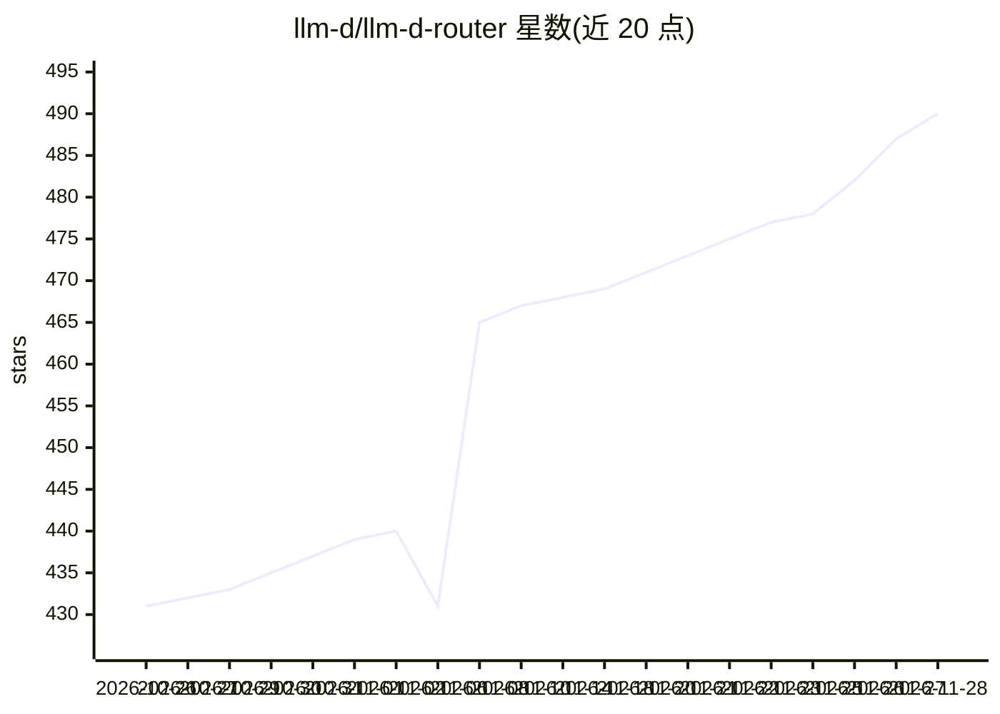

# llm-d/llm-d-router

⭐ 490 · Go · Apache-2.0 · 推送 2026-11-27 · [GitHub](https://github.com/llm-d/llm-d-router) · [官网](https://llm-d.ai/docs/architecture/core/router) · 组织维护

**Kubernetes 上 LLM 推理请求的路由与调度入口**

llm-d Router（原名 Inference Scheduler）是面向 LLM 推理流量的路由组件：基于 Endpoint Picker（EPP）结合 KV-cache 局部性、当前负载与优先级做请求放置决策，支持前缀缓存感知路由、请求优先级与流控。部署上分 Standalone 模式（自管 Envoy，sidecar 或独立 service 拓扑）和 Gateway 模式（经由 Kubernetes Gateway API 与 L7 负载均衡器集成）；另含 Disaggregation Sidecar 编排 P/D、E/P/D 多阶段推理。README 未给出直接安装命令，部署经由 Helm chart。

## 筛选速览

| 维度 | 判定 | 备注 |
|---|---|---|
| AI 角色 | `ai-ecosystem` | LLM/agent 周边工具 |
| 许可风险 | `permissive` | Apache-2.0 |
| 部署形态 | `library` | 以包/库形式分发 |
| 模型依赖 | — | README 未给出锁定关系 |
| 硬件要求 | — | 无带数字的原话,不猜 |
| 安装摩擦 | `low` | 无编译、无系统依赖或容器化 |
| 成熟度 | — | 结构信号不足 |

## 能力要点

- EPP 基于 KV-cache 局部性、负载与优先级做端点选择决策
- 通过 ext-proc 协议与 Envoy 等 L7 代理集成注入实时信号
- 两种部署模式：Standalone（自管 Envoy）与 Gateway 模式
- Disaggregation Sidecar 编排 P/D、E/P/D 分阶段推理与 KV-cache 传输

## 适用场景

- 在 Kubernetes 上为多副本 LLM 推理服务做负载与前缀缓存感知路由
- 模型 A/B 测试与金丝雀发布时按模型名改写管理流量
- Prefill/Decode 分离部署时协调各阶段 worker 的 KV-cache 传输

## 场景标签

`模型网关` `推理引擎` · 领域:Agent 开发

## 证据(README 行号)

> L15: The **llm-d Router** is the intelligent entry point for inference traffic, delivering LLM load and prefix-cache awa
> L25: - **Endpoint Picker (EPP)**: The intelligent routing engine that serves as the "brain" of the router. It evaluates 

## 星数曲线

2026-10-26 431 → 2026-11-28 490（+59）

---
*卡片 v1 · prompt 1.4 · 生成 2026-11-25 · 置信度 high · 依据 README sha `3c6c307a3c64` · [字段定义](../../DATASET.md)*
