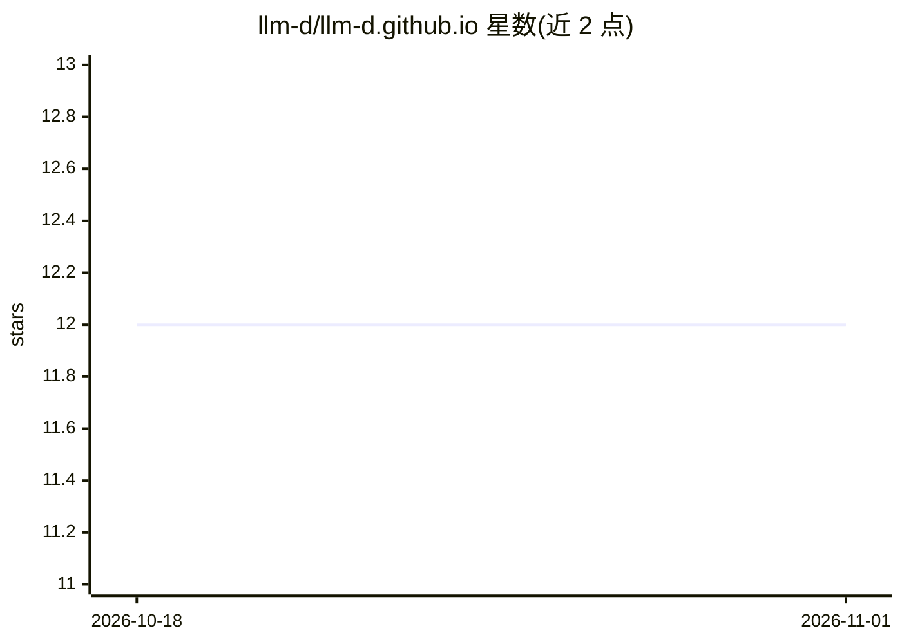

# llm-d/llm-d.github.io

⭐ 12 · MDX · Apache-2.0 · 推送 2026-10-30 · [GitHub](https://github.com/llm-d/llm-d.github.io) · [官网](https://llm-d.ai) · 组织维护

**llm-d 项目官网与文档站（llm-d.ai）的源码仓库**

使用 Docusaurus 构建的 llm-d 项目站点，含落地页、文档、博客与社区页面。文档内容从主仓库 llm-d/llm-d 同步，发布版本以快照形式冻结在 versioned_docs/ 下，并将链接固定到不可变 source refs；社区页面（贡献指南、行为准则、安全等）在同步时由上游仓库根文件生成。提供 llmd-site Go CLI 处理同步、版本切割与 refs 校验，部署走 GitHub Pages，PR 预览可用 Netlify。面向 llm-d 项目的文档维护者与贡献者。

## 筛选速览

| 维度 | 判定 | 备注 |
|---|---|---|
| AI 角色 | `ai-knowledge` | 知识聚合/清单类 |
| 许可风险 | `permissive` | Apache-2.0 |
| 部署形态 | `None` |  |
| 模型依赖 | — | README 未给出锁定关系 |
| 硬件要求 | — | 无带数字的原话,不猜 |
| 安装摩擦 | `low` | 无编译、无系统依赖或容器化 |
| 成熟度 | — | 结构信号不足 |

## 能力要点

- 文档从 llm-d/llm-d 主仓库自动同步，dev 版位于 /docs/dev
- 发布版本冻结于 versioned_docs/ 并将链接固定到不可变 refs
- llmd-site Go CLI 支持同步、版本切割与 refs 校验
- GitHub Pages 部署，Netlify 做 PR 预览

## 适用场景

- 本地预览与编辑 llm-d 文档
- 切割并冻结一个文档发布版本
- 了解 llm-d 项目的文档构建与部署流程

## 场景标签

 · 领域:开发者文档/站点基础设施

## 证据(README 行号)

> L3: Source for llm-d.ai — landing page, documentation, blog, and
> L7: Doc content is synced from llm-d/llm-d; released

## 星数曲线

2026-10-18 12 → 2026-11-01 12（+0）

---
*卡片 v1 · prompt 1.4 · 生成 2026-11-01 · 置信度 mid · 依据 README sha `00b854549f32` · [字段定义](../../DATASET.md)*
