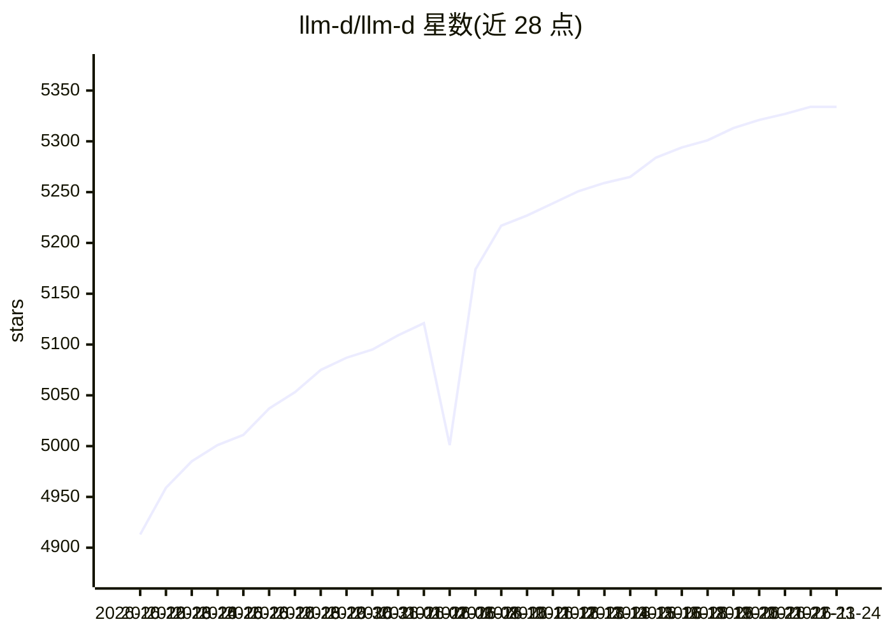

# llm-d/llm-d

⭐ 5,334 · Python · Apache-2.0 · 推送 2026-11-22 · [GitHub](https://github.com/llm-d/llm-d) · [官网](https://www.llm-d.ai) · 组织维护

**Kubernetes 上的分布式 LLM 推理编排栈**

llm-d 是面向生产部署的高性能分布式推理服务栈，运行在 Kubernetes 上，由 CNCF 沙箱项目维护（Red Hat、Google Cloud、IBM Research、CoreWeave、NVIDIA 发起）。它在 vLLM、SGLang 等模型服务器之上提供编排与优化：前缀缓存与负载感知的智能路由、分层 KV 缓存卸载与全局索引、prefill/decode 分离与宽专家并行、agent 会话感知调度，以及多租户 QoS、零停机升级、SLO 感知自动扩缩与端到端可观测。通过 well-lit path 指南与 Helm charts 提供基准测试过的部署配方。

## 筛选速览

| 维度 | 判定 | 备注 |
|---|---|---|
| AI 角色 | `ai-ecosystem` | LLM/agent 周边工具 |
| 许可风险 | `permissive` | Apache-2.0 |
| 部署形态 | `desktop` | 安装包/桌面程序 |
| 模型依赖 | local-ok | 支持本地模型 |
| 硬件要求 | — | 无带数字的原话,不猜 |
| 安装摩擦 | `low` | 无编译、无系统依赖或容器化 |
| 成熟度 | — | 结构信号不足 |

## 能力要点

- 前缀缓存与负载感知智能路由，支持预测延迟调度
- 分层 KV-Cache 管理：卸载到 CPU 或磁盘并做全局索引
- 大模型服务：prefill/decode 分离与宽专家并行
- 多租户 QoS、零停机操作与 SLO 感知自动扩缩

## 适用场景

- 在 Kubernetes 上以生产级方式部署高规模 LLM 推理服务
- 跨 NVIDIA/AMD GPU 与 TPU 环境运行大模型推理
- 为多轮 agent 工作流提供会话感知的推理服务
- 用 OpenAI 兼容 Batch API 管理大规模离线推理任务

## 场景标签

`推理引擎` · 领域:训练与推理

## 证据(README 行号)

> L11: llm-d is a high-performance distributed inference serving stack optimized for production deployments on Kubernetes.
> L17: Model servers like vLLM and SGLang handle efficiently running large language models on accelerators. llm-d provides
> L64: llm-d accelerates distributed inference by integrating industry-standard open technologies like vLLM and Kubernetes

## 星数曲线

2026-10-22 4,913 → 2026-11-24 5,334（+421）

---
*卡片 v1 · prompt 1.4 · 生成 2026-11-22 · 置信度 high · 依据 README sha `28bc63370fe3` · [字段定义](../../DATASET.md)*
