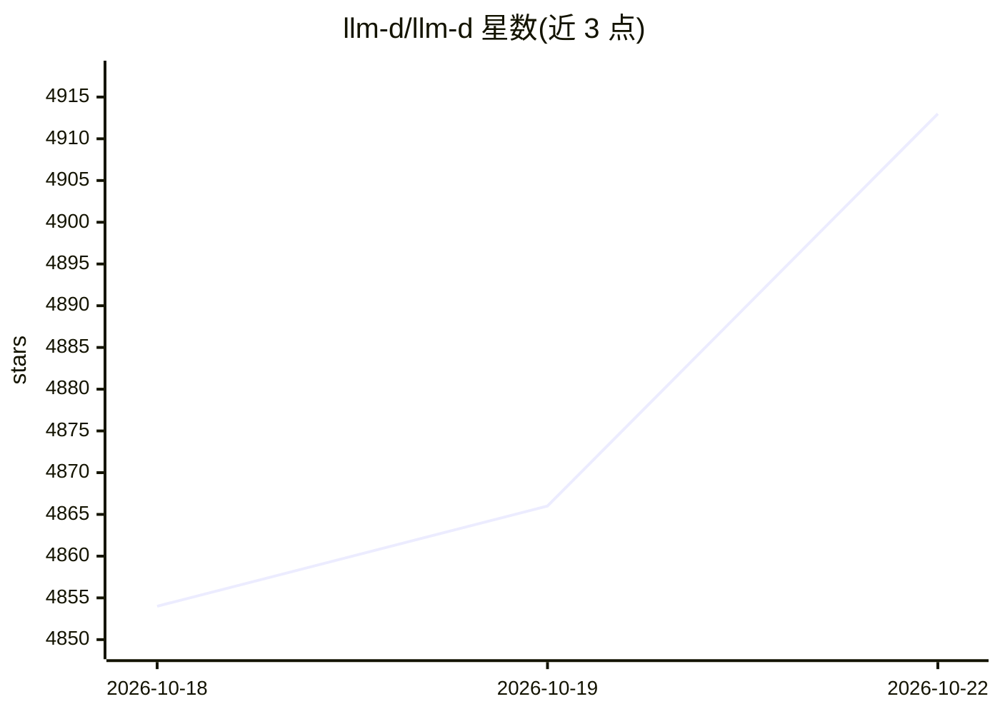

# llm-d/llm-d

⭐ 4,959 · Python · Apache-2.0 · 推送 2026-10-22 · [GitHub](https://github.com/llm-d/llm-d) · [官网](https://www.llm-d.ai) · 组织维护

**Kubernetes 上的 LLM 分布式推理服务编排栈**

llm-d 是运行于 Kubernetes 的高性能分布式推理服务栈，在 vLLM、SGLang 等模型服务器之上提供编排与优化：前缀缓存与负载感知的智能路由、分层 KV-Cache 卸载（CPU/磁盘）、预填充/解码分离与宽专家并行的大模型服务、多租户流控与 SLO 感知自动扩缩容、OpenAI 兼容 Batch API 的离线批处理。面向在生产环境部署大规模 LLM 推理的团队；提供带基准的 well-lit path 指南与 Helm charts 快速部署，通过 Quickstart 指南安装，依赖 Kubernetes 环境。限制：自身不直接运行模型，需搭配模型服务器使用。

## 筛选速览

| 维度 | 判定 | 备注 |
|---|---|---|
| AI 角色 | `ai-ecosystem` | LLM/agent 周边工具 |
| 许可风险 | `permissive` | Apache-2.0 |
| 部署形态 | `desktop` | 安装包/桌面程序 |
| 模型依赖 | local-ok | 支持本地模型 |
| 硬件要求 | — | 无带数字的原话,不猜 |
| 安装摩擦 | `low` | 无编译、无系统依赖或容器化 |
| 成熟度 | — | 结构信号不足 |

## 能力要点

- 前缀缓存感知路由与预测延迟调度（实验性）
- KV-Cache 分层卸载至 CPU/磁盘及全局索引
- 预填充/解码分离与宽专家并行服务大模型
- 多租户流控与 SLO 感知自动扩缩容

## 适用场景

- 在 Kubernetes 集群上高规模服务 LLM 推理流量
- 通过预填充/解码分离部署 DeepSeek-R1 等大模型
- 大规模离线批处理推理（OpenAI 兼容 Batch API）

## 场景标签

`推理引擎` · 领域:训练与推理

## 证据(README 行号)

> L11: llm-d is a high-performance distributed inference serving stack optimized for production deployments on Kubernetes.
> L17: Model servers like vLLM and SGLang handle efficiently running large language models on accelerators. llm-d provides

## 星数曲线

2026-10-18 4,854 → 2026-10-22 4,913（+59）

---
*卡片 v1 · prompt 1.4 · 生成 2026-10-20 · 置信度 high · 依据 README sha `e0d36f2c1de7` · [字段定义](../../DATASET.md)*
