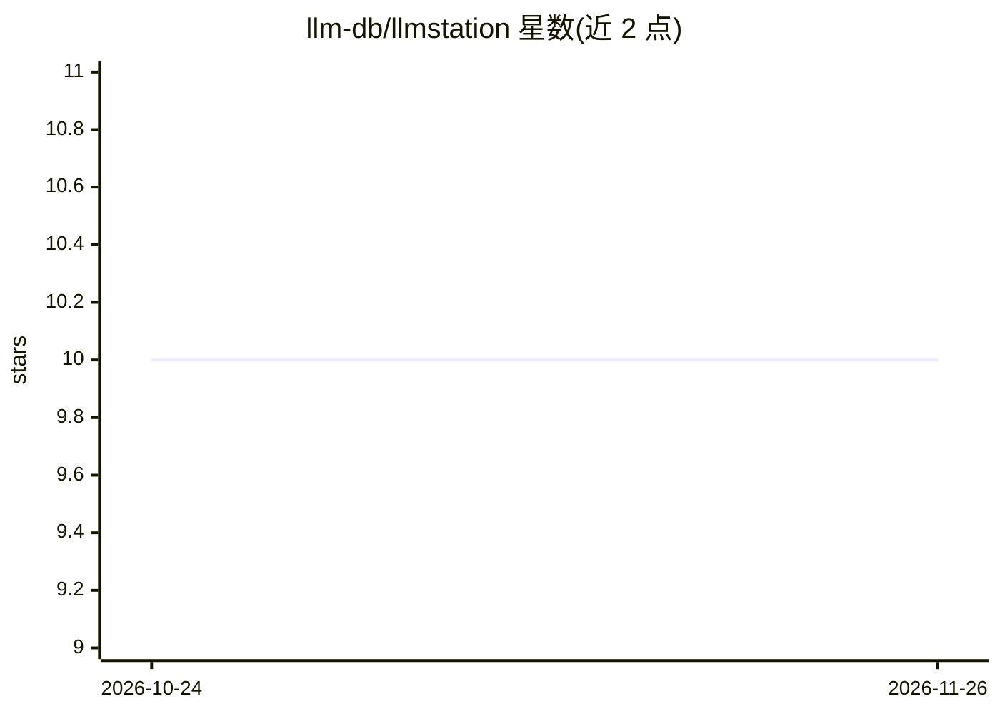

# llm-db/llmstation

⭐ 10 · Python · Apache-2.0 · 推送 2026-04-21 · [GitHub](https://github.com/llm-db/llmstation) · [官网](https://www.usenix.org/conference/atc25/presentation/he-yongjun) · 组织维护

**LLM 微调与推理复用系统的论文复现实验工件**

USENIX ATC 2025 论文《Resource Multiplexing in Tuning and Serving Large Language Models》的 artifact 仓库，用于复现论文图 4、8-13 的实验结果。提供 LLMStation 系统、FineInfer、chunked-training 及 vLLM+torchtune 基线的完整基准脚本，含两套 Conda 环境搭建、定制的 PyTorch 2.4.0 与 vLLM 0.6.3 源码构建、数据集/模型下载及 NVIDIA MPS 等运行配置说明。面向需要复现该论文实验或研究微调-服务资源复用的研究人员。

## 筛选速览

| 维度 | 判定 | 备注 |
|---|---|---|
| AI 角色 | `ai-knowledge` | 知识聚合/清单类 |
| 许可风险 | `permissive` | Apache-2.0 |
| 部署形态 | `library` | 以包/库形式分发 |
| 模型依赖 | local-ok | 支持本地模型 |
| 硬件要求 | — | 无带数字的原话,不猜 |
| 安装摩擦 | `high` | 编译与系统依赖俱全 |
| 成熟度 | — | 结构信号不足 |

## 能力要点

- 提供 LLMStation、FineInfer、chunked-training 与 vLLM+torchtune 四种方案的基准脚本
- 基于定制化的 PyTorch 2.4.0 与 vLLM 0.6.3 分支构建
- 支持 forward/backward tasklets 与等待时间等调度参数调整
- 覆盖 LoRA 分布、rank、chunk size 等多变量实验复现

## 适用场景

- 复现 USENIX ATC 2025 论文中的实验图表
- 研究 LoRA 微调与推理共置时的资源调度
- 在自己的 GPU 环境中基准测试微调+服务复用方案

## 场景标签

`微调` `推理引擎` · 领域:训练与推理

## 证据(README 行号)

> L1: # ATC '25 Artifact
> L94: ### Benchmark
> L163: For ease of reproduction, the script here uses fixed parameters entered by the users but they can be dynamically a

## 星数曲线

2026-10-24 10 → 2026-11-26 10（+0）

---
*卡片 v1 · prompt 1.4 · 生成 2026-11-20 · 置信度 high · 依据 README sha `a434faa4ada9` · [字段定义](../../DATASET.md)*
