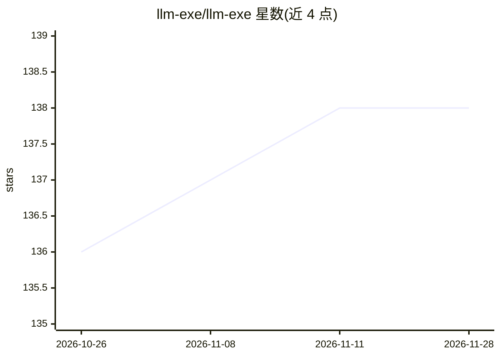

# llm-exe/llm-exe

⭐ 138 · TypeScript · MIT · 推送 2026-11-27 · [GitHub](https://github.com/llm-exe/llm-exe) · [官网](https://llm-exe.com) · 个人维护

**JS/TS 库：提供建构块简化 LLM 应用开发维护**

面向 JavaScript/TypeScript 的 LLM 应用开发包，提供 useLlm、createChatPrompt、createParser、createLlmExecutor、defineSchema 等构件：提示词模板支持 Handlebars 语法，内置解析器将 LLM 文本回复转为带类型的值（JSON、数字、布尔、列表等），支持自定义解析器与 schema 校验；提供状态管理（对话历史）、onSuccess/onError/onComplete 事件钩子用于日志与指标，支持 LLM 函数调用与执行器嵌套调用。通过 npm 安装，ESM-first 且兼容 CommonJS。

## 筛选速览

| 维度 | 判定 | 备注 |
|---|---|---|
| AI 角色 | `ai-ecosystem` | LLM/agent 周边工具 |
| 许可风险 | `permissive` | MIT |
| 部署形态 | `library` | 以包/库形式分发 |
| 模型依赖 | local-ok | 支持本地模型 |
| 硬件要求 | — | 无带数字的原话,不猜 |
| 安装摩擦 | `low` | 无编译、无系统依赖或容器化 |
| 成熟度 | — | 结构信号不足 |

## 能力要点

- useLlm/createChatPrompt/createParser/createLlmExecutor 等模块化构件
- 内置解析器将 LLM 回复转为带类型值，支持自定义解析器与 schema 校验
- 提供对话状态管理与 onSuccess/onError/onComplete 事件钩子
- 内置 chat-mock 模型可无 API key 本地测试

## 适用场景

- 在 TypeScript 中编写带类型输出的 LLM 函数
- 切换不同 LLM 提供商而无需修改调用代码
- 用 Handlebars 模板管理结构化提示词
- 为 LLM 调用添加日志与指标钩子

## 场景标签

`提示工程` · 领域:Agent 开发

## 证据(README 行号)

> L7: A package that provides simplified base components to make building and maintaining LLM-powered applications easier.
> L14: - Call LLMs from different providers without changing your code. (OpenAI/Anthropic/xAI/Google/AWS Bedrock/Ollama/De

## 星数曲线

2026-10-26 136 → 2026-11-28 138（+2）

---
*卡片 v1 · prompt 1.4 · 生成 2026-11-27 · 置信度 high · 依据 README sha `73a231e4c22b` · [字段定义](../../DATASET.md)*
