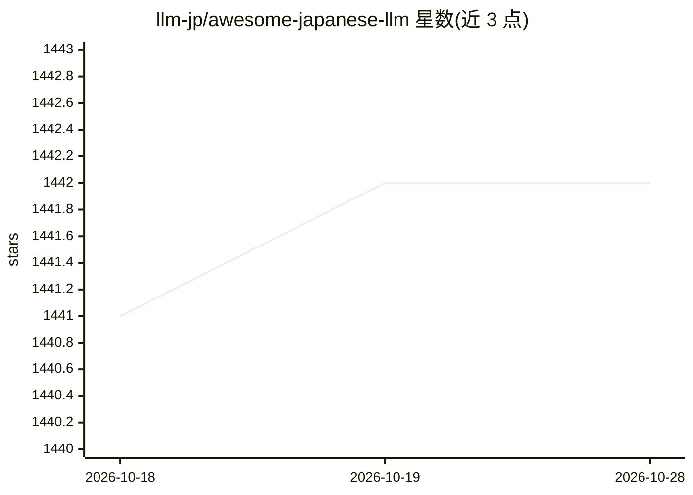

# llm-jp/awesome-japanese-llm

⭐ 1,442 · TypeScript · Apache-2.0 · 推送 2026-10-25 · [GitHub](https://github.com/llm-jp/awesome-japanese-llm) · [官网](https://llm-jp.github.io/awesome-japanese-llm) · 组织维护

**日本語 LLM 模型与评测基准的策展清单**

由 LLM-jp 组织维护的日本语大模型信息汇总清单：收录公开的日语中心 LLM，按从头预训练、基于既有模型微调等类别组织成表格，逐条列出发布年份、架构（Llama/GPT-NeoX/Qwen3 MoE 等）、上下文长度、训练数据、开发方与许可证；同时汇总日语 LLM 评测基准。通过 GitHub Issues 接受纠错与新增提案，并提供 llm-jp.github.io 的 Web 版阅读界面。注意清单声明不保证完整性与准确性。

## 筛选速览

| 维度 | 判定 | 备注 |
|---|---|---|
| AI 角色 | `ai-knowledge` | 知识聚合/清单类 |
| 许可风险 | `permissive` | Apache-2.0 |
| 部署形态 | `None` |  |
| 模型依赖 | — | README 未给出锁定关系 |
| 硬件要求 | — | 无带数字的原话,不猜 |
| 安装摩擦 | `low` | 无编译、无系统依赖或容器化 |
| 成熟度 | — | 结构信号不足 |

## 能力要点

- 按从头预训练/微调等类别组织的模型条目表格，含架构、训练数据与许可证信息
- 条目覆盖 LLM-jp、PLaMo、Sarashina、Tanuki、Fugaku-LLM 等系列
- 通过 GitHub Issues 接受纠错与模型新增提案
- 提供 Web 版阅读界面并汇总日语 LLM 评测基准

## 适用场景

- 查找和比较以日语为主训练的开源 LLM
- 确认各日语模型的许可证（MIT/Apache-2.0/非商用等）后再选用
- 了解日语 LLM 评测基准资源

## 场景标签

`精选清单` · 领域:学习与行业

## 证据(README 行号)

> L9: この記事は、一般公開されている日本語LLM（日本語を中心に学習されたLLM）および日本語LLM評価ベンチマークに関する情報をまとめたものです。情報は、有志により収集されており、その一部は論文や公開されているリソースなどから引用してい
> L24: ## テキスト生成に主に使うモデル

## 星数曲线

2026-10-18 1,441 → 2026-10-28 1,442（+1）

---
*卡片 v1 · prompt 1.4 · 生成 2026-10-21 · 置信度 high · 依据 README sha `d0096e8b44e6` · [字段定义](../../DATASET.md)*
