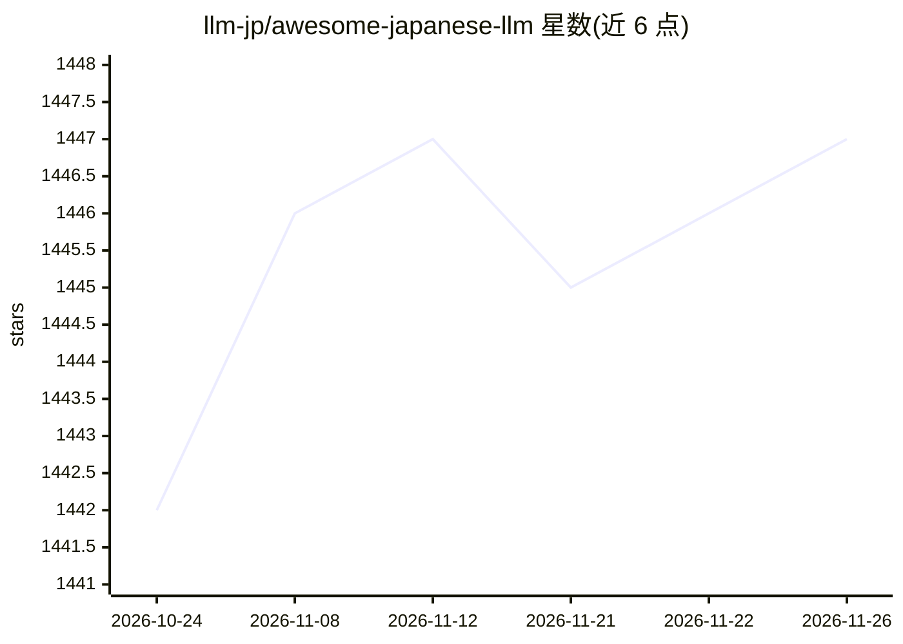

# llm-jp/awesome-japanese-llm

⭐ 1,447 · TypeScript · Apache-2.0 · 推送 2026-11-25 · [GitHub](https://github.com/llm-jp/awesome-japanese-llm) · [官网](https://llm-jp.github.io/awesome-japanese-llm) · 组织维护

**日语 LLM 及评测基准的汇总清单（有志维护）**

由有志者收集维护的日语 LLM 清单，汇总一般公开的、以日语为中心训练的语言模型及日语评测基准信息。以表格形式记录各模型的公开年份、架构、输入输出 token 数、预训练语料规模、开发方与许可证/使用条款，并提供 llm-jp.github.io/awesome-japanese-llm 的 Web 版浏览。信息部分引用自论文与公开资源，README 声明不保证完整性与准确性，且部分被收录模型采用非商业许可。

## 筛选速览

| 维度 | 判定 | 备注 |
|---|---|---|
| AI 角色 | `ai-knowledge` | 知识聚合/清单类 |
| 许可风险 | `permissive` | Apache-2.0 |
| 部署形态 | `None` |  |
| 模型依赖 | — | README 未给出锁定关系 |
| 硬件要求 | — | 无带数字的原话,不猜 |
| 安装摩擦 | `low` | 无编译、无系统依赖或容器化 |
| 成熟度 | — | 结构信号不足 |

## 能力要点

- 按架构分类（从零训练/多语言基础等）组织日语 LLM 表格
- 每条记录包含公开年、架构、token 数、训练语料规模与许可信息
- 同时汇总日语 LLM 评测基准信息
- 提供 Web 版站点与 GitHub Issues 反馈/追加渠道

## 适用场景

- 查找有哪些公开的日语中心训练 LLM 及其许可证
- 比较各日语模型的参数量与训练语料规模
- 为日语 LLM 评测寻找基准信息

## 场景标签

`精选清单` · 领域:学习与行业

## 证据(README 行号)

> L9: この記事は、一般公開されている日本語LLM（日本語を中心に学習されたLLM）および日本語LLM評価ベンチマークに関する情報をまとめたものです。情報は、有志により収集されており、その一部は論文や公開されているリソースなどから引用してい
> L24: ## テキスト生成に主に使うモデル

## 星数曲线

2026-10-24 1,442 → 2026-11-26 1,447（+5）

---
*卡片 v1 · prompt 1.4 · 生成 2026-11-24 · 置信度 high · 依据 README sha `684d93742ca0` · [字段定义](../../DATASET.md)*
