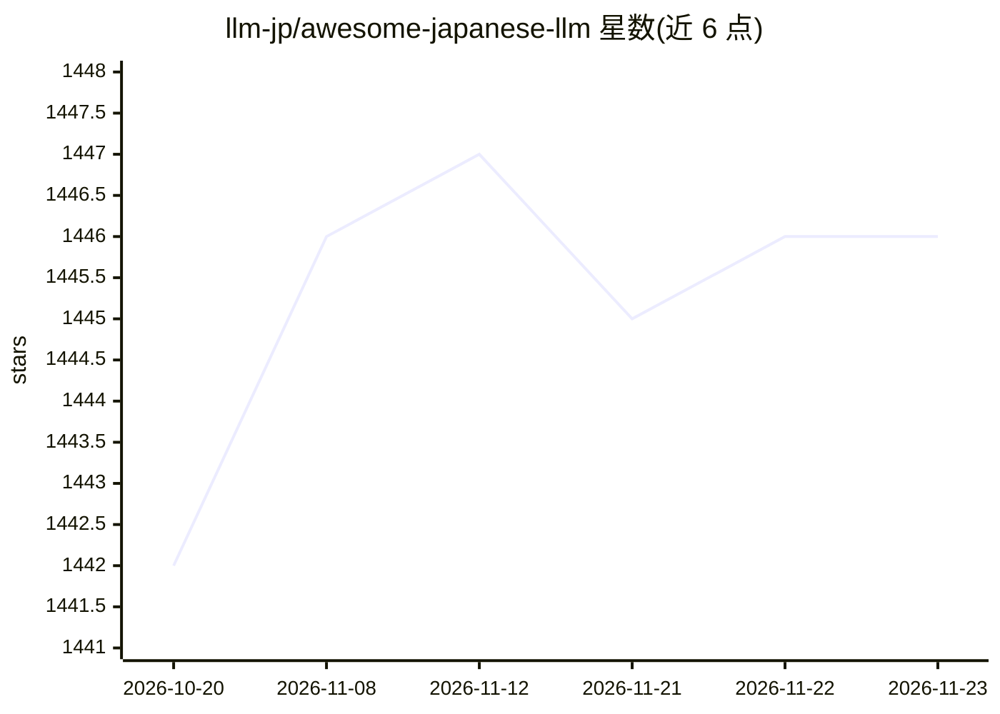

# llm-jp/awesome-japanese-llm

⭐ 1,446 · TypeScript · Apache-2.0 · 推送 2026-11-22 · [GitHub](https://github.com/llm-jp/awesome-japanese-llm) · [官网](https://llm-jp.github.io/awesome-japanese-llm) · 组织维护

**日语 LLM 与评测基准的公开信息汇总清单**

由志愿者收集整理的日语 LLM（以日语为中心训练的大语言模型）及日语 LLM 评测基准的信息汇总，以表格形式记录各模型的公开年份、架构、token 数、训练语料、开发方与许可证/使用条款，区分从零训练模型等类别。内容通过 GitHub Issues 接受纠错与新增提案，并提供 Web 版（llm-jp.github.io/awesome-japanese-llm）以便阅读。README 自述不保证信息完整性与准确性，且部分收录模型采用非商业许可。

## 筛选速览

| 维度 | 判定 | 备注 |
|---|---|---|
| AI 角色 | `ai-knowledge` | 知识聚合/清单类 |
| 许可风险 | `permissive` | Apache-2.0 |
| 部署形态 | `None` |  |
| 模型依赖 | — | README 未给出锁定关系 |
| 硬件要求 | — | 无带数字的原话,不猜 |
| 安装摩擦 | `low` | 无编译、无系统依赖或容器化 |
| 成熟度 | — | 结构信号不足 |

## 能力要点

- 汇总公开的日语 LLM 及其架构、训练语料、许可证信息
- 覆盖从零训练与基于既有架构的模型分类表格
- 提供 Web 版阅读页面
- 通过 GitHub Issues 接受纠错与模型追加提案

## 适用场景

- 查找以日语为中心训练的开源模型及其许可证条款
- 按架构与规模比较不同日语 LLM 的训练数据配置
- 了解日语 LLM 评测基准的资源

## 场景标签

`精选清单` `模型评测` · 领域:评测与运维

## 证据(README 行号)

> L9: この記事は、一般公開されている日本語LLM（日本語を中心に学習されたLLM）および日本語LLM評価ベンチマークに関する情報をまとめたものです。情報は、有志により収集されており、その一部は論文や公開されているリソースなどから引用してい
> L24: ## テキスト生成に主に使うモデル
> L32: ||公開年|アーキテクチャ|入出力で扱える トークン数|学習テキスト|開発元|ライセンス / 利用規約|

## 星数曲线

2026-10-20 1,442 → 2026-11-23 1,446（+4）

---
*卡片 v1 · prompt 1.4 · 生成 2026-11-23 · 置信度 high · 依据 README sha `861ddd9c1628` · [字段定义](../../DATASET.md)*
