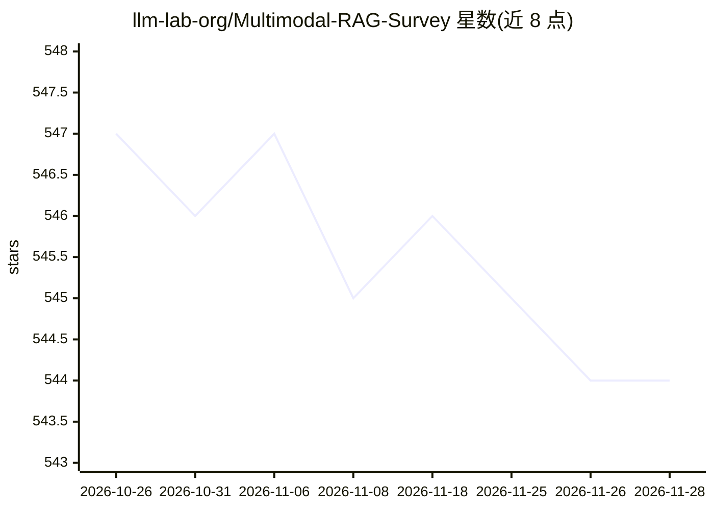

# llm-lab-org/Multimodal-RAG-Survey

⭐ 544 · 推送 2026-11-19 · [GitHub](https://github.com/llm-lab-org/Multimodal-RAG-Survey) · [官网](https://arxiv.org/abs/2502.08826) · 组织维护

**多模态 RAG 论文与数据集策展清单，服务研究人员**

配套综述论文《Ask in Any Modality》的论文收集仓库：将多模态检索增强生成（MM-RAG）相关论文按分类学组织，覆盖检索、融合、增强、生成等方法的进展与应用领域，并整理图文、视频、音频、医疗、时尚、QA 等模态的常用数据集与基准（含规模、模态、链接）。仓库随论文持续更新（记录新增论文、海报与幻灯片），面向从事该方向后续研究的研究人员，欢迎通过 PR 贡献新条目。

## 筛选速览

| 维度 | 判定 | 备注 |
|---|---|---|
| AI 角色 | `ai-knowledge` | 知识聚合/清单类 |
| 许可风险 | `none` | — |
| 部署形态 | `None` |  |
| 模型依赖 | — | README 未给出锁定关系 |
| 硬件要求 | — | 无带数字的原话,不猜 |
| 安装摩擦 | `low` | 无编译、无系统依赖或容器化 |
| 成熟度 | — | 结构信号不足 |

## 能力要点

- 按分类学组织多模态 RAG 论文，覆盖方法与应用领域
- 整理 6 大类数据集与基准：图文/视频/音频/医疗/时尚/QA，附规模与链接
- 持续更新：2025-2026 记录多次新增论文与 100+ 新基准数据集

## 适用场景

- 调研多模态 RAG 的方法分类与开放挑战
- 为检索增强的视觉/视频/音频任务挑选评测数据集
- 跟进 MM-RAG 领域新发表的论文与基准

## 场景标签

`精选清单` `科研工具` · 领域:学习与行业

## 证据(README 行号)

> L5: This repository is designed to collect and categorize papers related to Multimodal Retrieval-Augmented Generation (R
> L34: This survey offers a structured and comprehensive analysis of Multimodal RAG systems, covering datasets, benchmarks

## 星数曲线

2026-10-26 547 → 2026-11-28 544（-3）

---
*卡片 v1 · prompt 1.4 · 生成 2026-11-25 · 置信度 high · 依据 README sha `1f0b0a7418d0` · [字段定义](../../DATASET.md)*
